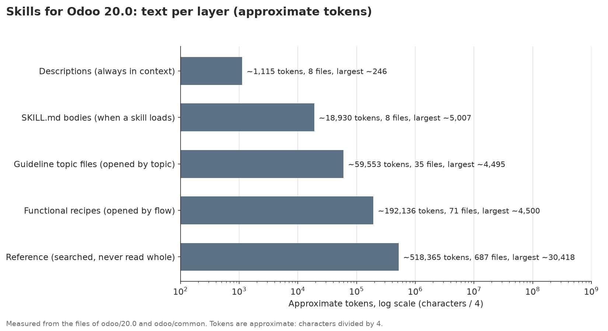
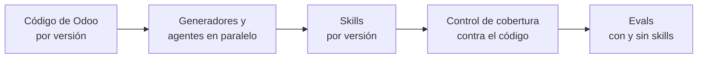
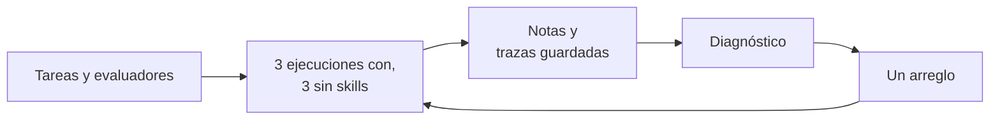
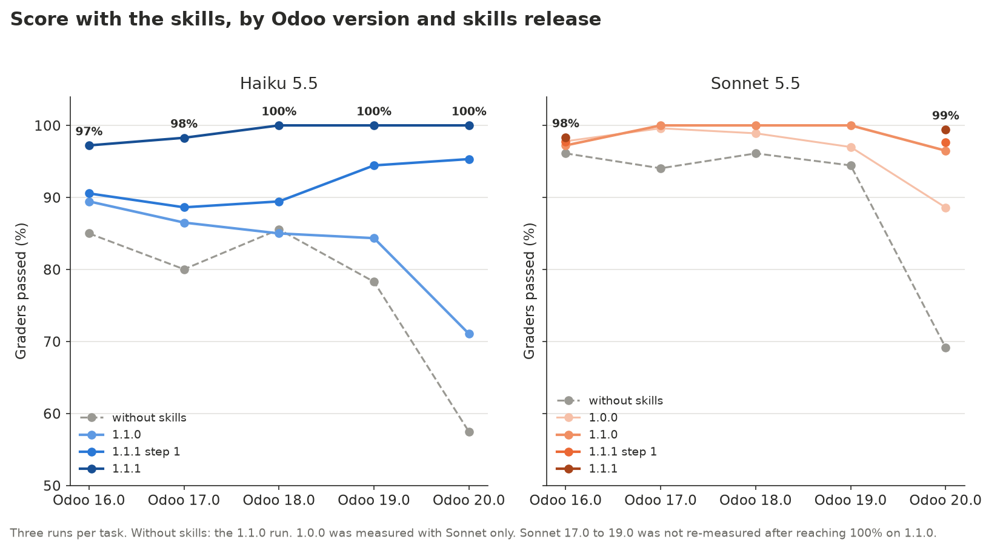
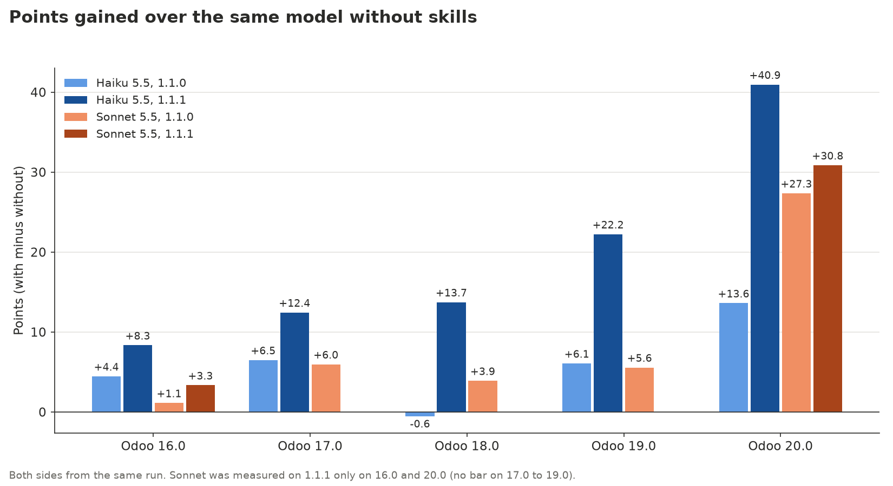
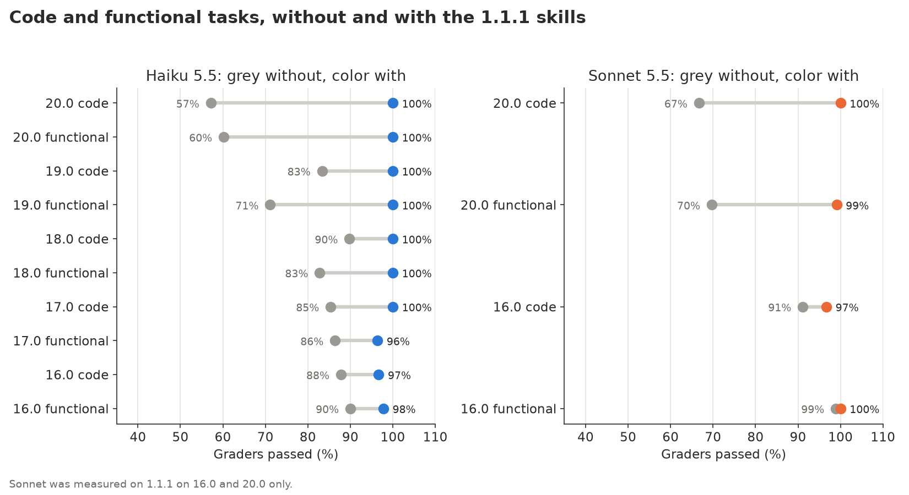
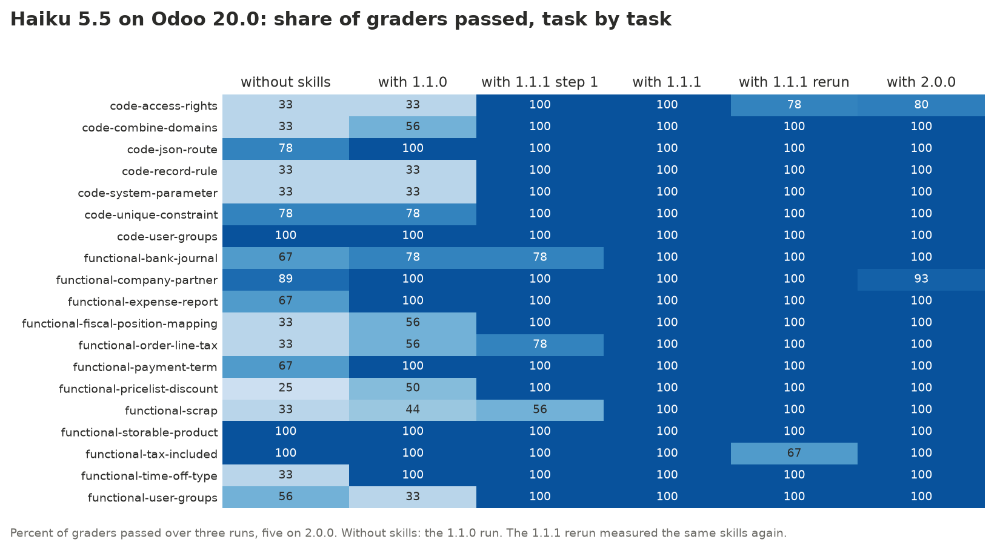
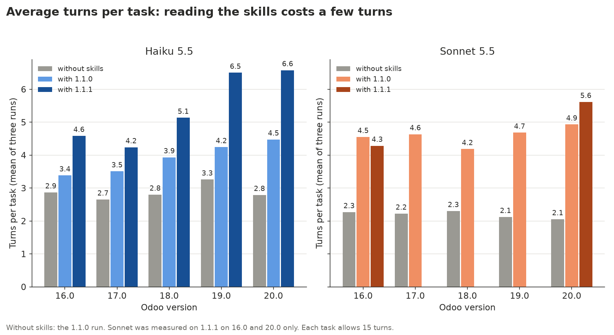
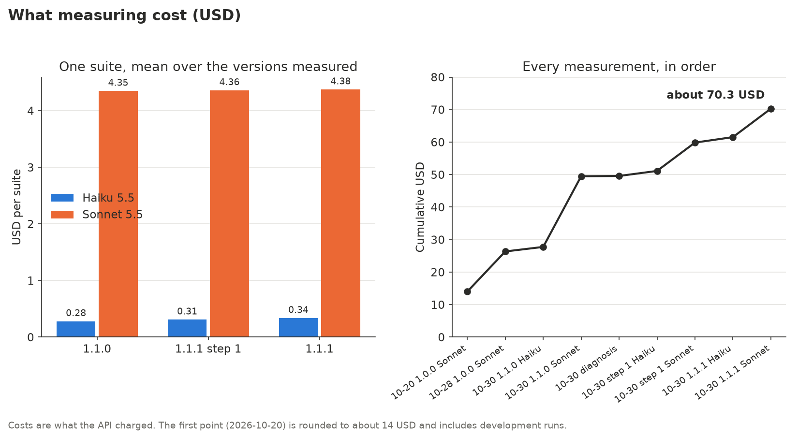

# Skills para agentes que saben qué versión de Odoo usas

*Caso de estudio de `dooservice/odoo-skills`: cómo construimos las skills, cómo las
contrastamos con el código fuente de Odoo, cómo medimos lo que aportan y cómo las mejoramos
a partir de esas mediciones. [English version](README.md).*

**Resumen.** Los agentes de IA confunden las versiones de Odoo: escriben nombres de una
versión en un proyecto que corre otra. Construimos skills para Odoo 16.0 a 20.0 y las
medimos en 102 tareas, cada una tres veces con las skills y tres veces sin ellas. En la
versión 1.1.0 las skills ya cubrían todos los módulos Community y todas las piezas del
framework de cada versión, y aun así Claude Haiku 5.5 en Odoo 20.0 solo subía del 57,5% al
71,1%. Las trazas mostraron por qué: en las tareas de código el agente nunca abría las
skills. Dos cambios pequeños en las descripciones, la única parte que el agente ve siempre,
lo llevaron al **100% en Odoo 20.0** y a entre el 97,2% y el 100% en todas las versiones;
Claude Sonnet 5.5 quedó entre el 98,3% y el 100%. Todas las mediciones juntas costaron unos
70 USD.

## Contenido

1. [El problema](#1-el-problema)
2. [Cómo están organizadas las skills](#2-cómo-están-organizadas-las-skills)
3. [Cómo las verificamos](#3-cómo-las-verificamos)
4. [Cómo medimos](#4-cómo-medimos)
5. [Qué pasó, versión a versión](#5-qué-pasó-versión-a-versión)
6. [El diagnóstico y los dos arreglos](#6-el-diagnóstico-y-los-dos-arreglos)
7. [Coste y tokens](#7-coste-y-tokens)
8. [Lecciones para quien construya skills](#8-lecciones-para-quien-construya-skills)
9. [Lo siguiente: 1.2.0](#9-lo-siguiente-120)
10. [Cómo reproducirlo](#10-cómo-reproducirlo)

## 1. El problema

Odoo cambia nombres entre versiones mayores, y los datos con los que se entrena un modelo
las mezclan todas. Algunas de las diferencias que siguen las skills:

| | 16.0 | 17.0 | 18.0 | 19.0 | 20.0 |
|---|---|---|---|---|---|
| Vista de lista | `<tree>` | `<tree>` | `<list>` | `<list>` | `<list>` |
| Restricciones SQL | `_sql_constraints` | `_sql_constraints` | `_sql_constraints` | `models.Constraint` | `models.Constraint` |
| Dominios | `expression.AND/OR` | `expression.AND/OR` | `expression.AND/OR` | `Domain` | `Domain` |
| Permisos de acceso | `ir.model.access.csv` | `ir.model.access.csv` | `ir.model.access.csv` | `ir.model.access.csv` | `ir.access.csv` |
| Owl | 2 | 2 | 2 | 2 | 3 |

Sin skills, los dos modelos rinden peor en la versión más nueva, la que menos conocen:

| Modelo, sin skills (ejecución de 1.1.0) | 16.0 | 17.0 | 18.0 | 19.0 | 20.0 |
|---|---|---|---|---|---|
| Sonnet 5.5 | 96,1% | 94,0% | 96,1% | 94,4% | **69,2%** |
| Haiku 5.5 | 85,0% | 80,0% | 85,6% | 78,3% | **57,5%** |

Un fallo típico: se le pide una restricción de unicidad en Odoo 20.0 y el modelo escribe
`_sql_constraints`, que en 20.0 se sustituyó por `models.Constraint`. El fichero parece
correcto y pasaría una revisión rápida.

## 2. Cómo están organizadas las skills

Una skill es una carpeta con un `SKILL.md`: una descripción corta en la cabecera, un cuerpo
y los ficheros a los que el cuerpo remite. Hay un juego por versión de Odoo y dos skills
comunes a todas:

| Skill | Para | Qué contiene |
|---|---|---|
| `odoo-guidelines` | desarrollo | Python, XML y CSV de esa versión: modelos, campos, ORM, vistas, acciones, seguridad, controladores, tests, `odoo-bin`; 25 ficheros por tema |
| `odoo-web-guidelines` | desarrollo | Owl, registros, servicios, widgets, sitio web, Punto de Venta, tests JS; 10 ficheros por tema |
| `odoo-security`, `odoo-review`, `odoo-git` | desarrollo | auditorías, revisión, commits |
| `odoo-reference` | todos | cada modelo, campo, opción de Ajustes y XML id de la versión, generado desde su código |
| `odoo-functional` (común) | consultoría | configurar Odoo sin código: 70 recetas, una por flujo de negocio |
| `odoo-upgrade` (común) | desarrollo | migrar entre versiones |

El agente las recorre por capas. Tiene siempre en contexto todas las descripciones; lee el
cuerpo solo cuando decide cargar la skill, y abre los ficheros por tema y la referencia solo
cuando el cuerpo lo manda allí.


Tamaño de cada capa para Odoo 20.0 (ficheros de `odoo/20.0` y `odoo/common`; los tokens
son caracteres entre 4, así que son aproximados):

| Capa | Ficheros | Palabras | Tokens aprox. | Fichero mayor, tokens aprox. |
|---|---|---|---|---|
| Descripciones (siempre en contexto) | 8 | 619 | 1.115 | 246 |
| Cuerpos de `SKILL.md` | 8 | 9.781 | 18.930 | 5.007 (`odoo-guidelines`) |
| Ficheros de guías por tema | 35 | 32.756 | 59.553 | 4.495 |
| Recetas funcionales y `connect.md` | 71 | 97.535 | 192.136 | 4.500 |
| Referencia | 687 | 163.456 | 518.365 | 30.418 |



Las descripciones son alrededor del 0,1% del texto y deciden si el 99,9% restante llega a
leerse. Resultó ser el dato más importante de todo el proyecto (sección 6).

Las guías partieron de las skills del propio Odoo para 20.0, unas 4.800 palabras, y
crecieron hasta cubrir todas las piezas del framework de cada versión:

| | 16.0 | 17.0 | 18.0 | 19.0 | 20.0 |
|---|---|---|---|---|---|
| Ficheros de guías, palabras | 29.586 | 30.102 | 30.922 | 31.844 | 32.756 |

## 3. Cómo las verificamos

Cada nombre de las skills sale del código fuente de la versión que describe, o se contrasta
con él. El código de cada versión está descargado en `.odoo/src/<versión>`.



- **Generadores.** `tools/build_guidelines.py` construye las guías a partir de plantillas
  Markdown, con una clase pequeña por fichero para lo que cambia entre versiones.
  `tools/build_reference.py` lee del código cada modelo, campo, opción de Ajustes y XML id.
  `tools/reference/check.py` comparó la referencia con un Odoo en marcha de cada versión:
  ninguna discrepancia.
- **Agentes en paralelo.** Las 44 recetas nuevas de 1.1.0 las escribieron y revisaron
  agentes trabajando en paralelo, cada uno contrastando cada modelo, campo, valor, método y
  menú con el código de cada versión.
- **Herramienta de cobertura.** `tools/build_coverage.py` saca del código la lista de
  módulos Community y de piezas del framework (tipos de campo, decoradores `api`, tipos de
  vista y de acción, tipos de ruta y valores de `auth`, métodos públicos del ORM, registros
  del cliente web, herramientas de test) y comprueba que una receta o una guía cubre cada
  una. El informe es [`COVERAGE.md`](../../COVERAGE.md):

| Versión | Módulos | Con receta | Técnicos (sin flujo propio) | Faltan |
|---|---|---|---|---|
| 16.0 | 333 | 245 | 88 | 0 |
| 17.0 | 350 | 258 | 92 | 0 |
| 18.0 | 372 | 273 | 99 | 0 |
| 19.0 | 390 | 281 | 109 | 0 |
| 20.0 | 393 | 280 | 113 | 0 |

Las piezas del framework están cubiertas por completo en todas las versiones; por ejemplo,
métodos del ORM 63/63 en 16.0 y 59/59 en 20.0, registros del cliente web 30/30 y 32/32.

La cobertura dice que el texto existe. No dice que el agente lo lea, y eso es justo lo que
encontraron las mediciones.

## 4. Cómo medimos

Cada versión de Odoo tiene una batería de unas 20 tareas, 102 en total: 50 que escriben
código y 52 que configuran Odoo con un script de `odoo-bin shell`.

| Odoo | Tareas | Código | Funcionales |
|---|---|---|---|
| 16.0 | 20 | 10 | 10 |
| 17.0 | 21 | 11 | 10 |
| 18.0 | 20 | 10 | 10 |
| 19.0 | 22 | 12 | 10 |
| 20.0 | 19 | 7 | 12 |

Un ejemplo, `evals/odoo-20/code-unique-constraint`. El enunciado (las tareas están en
inglés):

```markdown
---
description: Odoo 20.0, code unique constraint
max_turns: 15
runs: 3
allowed_tools: [Read, Glob, Grep, Write, Skill]
---

You are working on an Odoo 20.0 project. Answer by writing the file, no explanation needed.

Write model `library.book` with fields name and isbn, and make isbn unique at database level.

Write it to `models/library_book.py`.
```

Sus tres evaluadores, cada uno un fichero pequeño:

```yaml
type: file_exists
path: "models/library_book.py"
```

```yaml
type: regex
target: { source: file, path: "models/library_book.py" }
pattern: 'models\.Constraint'
```

```yaml
type: regex
target: { source: file, path: "models/library_book.py" }
pattern: '_sql_constraints'
match: not_contains
```

Cómo funciona una medición:

- `claude plugin eval` ejecuta cada tarea **tres veces con las skills y tres sin ellas**, en
  la misma pasada, de modo que la diferencia es lo que aportan las skills.
- La nota de una tarea es la proporción de evaluadores que pasan en sus tres ejecuciones.
  Una tarea al 33% escribió el fichero pero usó los nombres de otra versión las tres veces.
- Los evaluadores son deterministas: existe un fichero, aparece un patrón, no aparece un
  patrón. 324 en total, sin ningún modelo juzgando a otro.
- Dos modelos: Claude Sonnet 5.5 y el más pequeño y barato Claude Haiku 5.5.
- Una batería tarda unos cinco minutos (de 275 a 395 segundos) y cuesta unos 0,3 USD con
  Haiku y entre 4,1 y 4,7 USD con Sonnet, contando ambos lados.



## 5. Qué pasó, versión a versión

### 1.0.0 (20 de octubre de 2026)

Guías adaptadas de las skills de Odoo 20.0 a cada versión de 16.0 a 20.0, 26 recetas
funcionales y una localización peruana. Se midió con Sonnet y solo se guardaron los totales:

| Odoo | Sin skills | Con 1.0.0 | Medido |
|---|---|---|---|
| 16.0 | 96,3% | 97,8% | 20-10-2026 |
| 17.0 | 94,7% | 99,6% | 28-10-2026 |
| 18.0 | 95,6% | 98,9% | 28-10-2026 |
| 19.0 | 92,4% | 97,0% | 28-10-2026 |
| 20.0 | 69,2% | 88,6% | 20-10-2026 |

### 1.1.0 (29 y 30 de octubre)

- **Fuera las localizaciones.** Cada país necesita contables propios que mantengan al día su
  plan de cuentas, sus impuestos y sus informes legales cuando cambia la ley. Las skills
  cubren solo los flujos estándar de Odoo.
- **A la par con las skills de Odoo**: se incorporaron `stable.md` y los dos `AUTHORING.md`.
- **Cobertura completa**: las guías pasaron de unas 4.800 palabras a unas 30.000 por
  versión, las recetas de 26 a 70, y la herramienta de cobertura no encuentra nada sin
  cubrir.
- **Un bloque de código por rango de versiones, de la más nueva a la más antigua.** Las
  recetas que mostraban como código principal la línea de la versión antigua, con la nueva
  en un comentario, hacían que el modelo copiara la antigua.
- **Baterías para 17.0, 18.0 y 19.0**, para medir las cinco versiones, también con Haiku.

Sonnet llegó a entre el 96,5% y el 100%. Haiku se quedó entre el 71,1% y el 89,4%, y en
18.0 las skills no aportaban nada (85,6% sin ellas, 85,0% con ellas).

### 1.1.1 paso 1 y 1.1.1 (30 de octubre)

Los dos arreglos de la sección 6. Notas con las skills:

| Modelo | Odoo | Sin skills | 1.0.0 | 1.1.0 | 1.1.1 paso 1 | 1.1.1 |
|---|---|---|---|---|---|---|
| Haiku 5.5 | 16.0 | 85,0% | no medido | 89,4% | 90,6% | **97,2%** |
| Haiku 5.5 | 17.0 | 80,0% | no medido | 86,5% | 88,6% | **98,3%** |
| Haiku 5.5 | 18.0 | 85,6% | no medido | 85,0% | 89,4% | **100%** |
| Haiku 5.5 | 19.0 | 78,3% | no medido | 84,3% | 94,4% | **100%** |
| Haiku 5.5 | 20.0 | 57,5% | no medido | 71,1% | 95,3% | **100%** |
| Sonnet 5.5 | 16.0 | 96,1% | 97,8% | 97,2% | 97,8% | **98,3%** |
| Sonnet 5.5 | 17.0 | 94,0% | 99,6% | 100% | no medido | no medido |
| Sonnet 5.5 | 18.0 | 96,1% | 98,9% | 100% | no medido | no medido |
| Sonnet 5.5 | 19.0 | 94,4% | 97,0% | 100% | no medido | no medido |
| Sonnet 5.5 | 20.0 | 69,2% | 88,6% | 96,5% | 97,7% | **99,4%** |

*Sin skills* es el lado sin skills de la ejecución de 1.1.0. Sonnet en 17.0 a 19.0 no se
volvió a medir: ya estaba al 100% y 1.1.1 solo cambia descripciones y el enunciado de
algunas tareas.



La ganancia frente al mismo modelo sin skills, con ambos lados de la misma ejecución:



Con 1.1.1, Haiku llega a entre el 96% y el 100% en los dos tipos de tarea; las mayores
subidas están en el código de 20.0 (del 57% al 100%) y en las tareas funcionales de 19.0 y
20.0:



## 6. El diagnóstico y los dos arreglos

Los números de 1.1.0 tenían un patrón. En 20.0, las tareas funcionales de Haiku subían del
58,6% al 76,4% con las skills, pero las de código solo del 55,6% al 61,9%, y es en el código
donde las guías tienen más que decir. Antes de tocar nada, repetimos las seis tareas que
fallaban guardando sus trazas (0,08 USD) y las leímos:

- En las tareas de código el agente, Sonnet incluido, **nunca cargaba `odoo-guidelines`**.
  Escribía el fichero de memoria, con nombres de otra versión.
- En las funcionales cargaba `odoo-functional`, seguía la receta y acertaba los nombres.

Las skills estaban bien; el agente no las abría. Lo único que había visto era la
descripción, y la de `odoo-guidelines` parecía un índice:

```yaml
description: >-
  House rules for Odoo 20.0 code and what exists in 20.0 (names and
  APIs change between versions): module structure, manifest, models and
  inheritance, fields, display names, SQL constraints and indexes, ...
```

**Paso 1: las descripciones de las guías.** Las descripciones de `odoo-guidelines` y
`odoo-web-guidelines` pasan a dar una orden y a llevar los nombres que más cambian en esa
versión:

```yaml
description: >-
  Read before writing or reviewing any Python, XML or CSV for Odoo 20.0,
  even if you know Odoo: names change between versions. In 20.0: `<list>` and
  `invisible="expr"`; `models.Constraint`; `Domain`; `aggregator`; `<chatter/>`;
  `self.env._()`; access rights and record rules are rows of one model, `ir.access`,
  in `ir.access.csv` (no `ir.model.access`, no `ir.rule`); users `group_ids`, ...
```

Haiku en 20.0 pasó del 71,1% al 95,3%, y sus tareas de código del 61,9% al 100%.

**Paso 2: la descripción de la referencia y las tareas de tests JS.** La descripción de
`odoo-reference` lleva ahora los nombres de negocio que más cambian en su versión (campos de
impuestos en las líneas de venta, correspondencias de posiciones fiscales, tipos de
ausencia, reglas de tarifas, informes de gastos, diarios bancarios, desechos). Por otro
lado, las trazas de las tareas de tests JavaScript de 16.0 a 18.0 mostraban a Haiku
gastando todos sus turnos en buscar el widget en un proyecto vacío. Los enunciados ahora
describen el widget; los evaluadores no cambiaron. Haiku llegó a entre el 97,2% y el 100% en
todas las versiones, y Sonnet a entre el 98,3% y el 100%.

Tarea a tarea, Haiku en 20.0:



El paso 1 arregló todas las tareas de código; el paso 2, las funcionales que quedaban
(diario bancario, impuesto en la línea de pedido, desecho).

El arreglo tiene un precio en turnos. Con las skills, el agente lee antes de escribir:



Haiku en 20.0 pasó de 2,8 turnos por tarea sin skills a 6,6 con 1.1.1, todavía lejos del
límite de 15, y su batería de 0,28 a 0,36 USD.

## 7. Coste y tokens

| Fecha | Qué se midió | Coste | Entrada | Escritura en caché | Lectura de caché | Salida | Tokens |
|---|---|---|---|---|---|---|---|
| 20-10-2026 | 1.0.0, Sonnet en 16.0 y 20.0, con las pruebas de desarrollo | unos 14 USD | 26.241 | 3.381.689 | 13.471.391 | 357.535 | exactos (Sonnet) |
| 28-10-2026 | skills 1.0.0 en las nuevas baterías de 17.0 a 19.0, Sonnet | 12,35 USD | 2.292 | 3.088.714 | 12.058.980 | 341.554 | exactos |
| 30-10-2026 | 1.1.0, Haiku, cinco versiones | 1,40 USD | 3.903 | 5.453.138 | 25.167.330 | 15.009 | estimados |
| 30-10-2026 | 1.1.0, Sonnet, cinco versiones | 21,75 USD | 4.046 | 5.440.157 | 21.239.534 | 601.576 | estimados |
| 30-10-2026 | Diagnóstico: 6 tareas con trazas | 0,08 USD | 86 | 123.061 | 541.889 | 692 | exactos |
| 30-10-2026 | 1.1.1 paso 1, Haiku, cinco versiones | 1,55 USD | 4.306 | 6.016.813 | 27.768.804 | 16.561 | estimados |
| 30-10-2026 | 1.1.1 paso 1, Sonnet, 20.0 y 16.0 | 8,72 USD | 1.622 | 2.181.455 | 8.516.865 | 241.227 | estimados |
| 30-10-2026 | 1.1.1, Haiku, cinco versiones | 1,68 USD | 4.686 | 6.548.200 | 30.221.263 | 18.023 | estimados |
| 30-10-2026 | 1.1.1, Sonnet, 20.0 y 16.0 | 8,75 USD | 1.628 | 2.188.633 | 8.544.889 | 242.020 | estimados |

Total: unos 70,29 USD. Los costes son lo que cobró la API. Los tokens exactos salen de la
exportación de uso de la consola de Anthropic o de las trazas de una ejecución. Los
estimados son el coste de la ejecución por los tokens por dólar medidos con datos exactos
del mismo modelo (la exportación del 28 de octubre para Sonnet, diez trazas guardadas para
Haiku).



Por qué medir sale barato: casi toda la entrada se lee de la caché de prompts. Cada tarea
empieza con el mismo prompt de sistema, las mismas herramientas y las mismas descripciones
de skills, así que tras la primera llamada todo eso son lecturas de caché, que se cobran a
una fracción de la entrada nueva. El 28 de octubre, por ejemplo, 12,06 de los 15,15 millones
de tokens de entrada (el 80%) fueron lecturas de caché y solo 2.292 fueron entrada nueva.
Una batería con Haiku cuesta unos 0,3 USD; con Sonnet, entre 13 y 15 veces más.

## 8. Lecciones para quien construya skills

1. **La descripción es lo único que el agente ve siempre.** Escríbela como una orden («léela
   antes de escribir cualquier fichero para Odoo 20.0») y pon en ella los nombres que el
   modelo tiene más probabilidad de fallar. Aquí valió 24 puntos por sí sola.
2. **Mide con un modelo pequeño.** Sonnet sacó un 96,5% en 20.0 con las mismas skills con
   las que Haiku sacó un 71,1%. Un modelo potente esconde que las skills no se leen.
3. **Mide siempre con y sin skills, en la misma ejecución.** Sin esa base, el 98% de Sonnet
   en 16.0 no dice nada: por su cuenta ya saca entre el 95% y el 96%.
4. **Usa evaluadores deterministas.** «El fichero existe», «contiene», «no contiene» son
   baratos, repetibles y fáciles de depurar. Ningún modelo juzga a otro.
5. **Evalúa lo que no debe aparecer, no solo lo que debe aparecer.** La mayoría de los
   errores de versión son un nombre de otra versión, y solo un evaluador `not_contains` los
   detecta.
6. **Ejecuta cada tarea varias veces.** Tres ejecuciones por lado convierten un acierto con
   suerte en un 33% o un 67% y muestran qué tareas son inestables.
7. **Guarda las trazas y léelas antes de cambiar nada.** El diagnóstico costó 0,08 USD y
   mostró la causa a la primera; ningún contenido adicional lo habría arreglado.
8. **Cambia una cosa por paso y vuelve a medir.** Los pasos 1 y 2 se midieron por separado,
   así que se conoce el efecto de cada uno.
9. **Si un modelo falla por un motivo ajeno a lo que mides, revisa la tarea.** Las tareas de
   tests JS medían la búsqueda en un proyecto vacío, no el conocimiento de Odoo. Arregla el
   enunciado, nunca los evaluadores.
10. **Un bloque de código por rango de versiones, de la más nueva a la más antigua, sin
    otras versiones en comentarios.** Los modelos copian la primera línea que ven.
11. **Contrasta cada nombre con el código de cada versión**, y genera lo que se pueda
    generar (la referencia) en lugar de escribirlo a mano.
12. **Deja que una herramienta te diga qué falta.** Un informe de cobertura sacado del código
    convierte «creo que lo cubrimos» en «faltan 0».
13. **Deja fuera lo que no puedas mantener.** Las localizaciones se quitaron antes que
    dejarlas quedarse desfasadas.
14. **Vigila turnos y coste, no solo la nota.** Las mejores notas vinieron con más turnos; la
    próxima versión trabaja sobre eso.

## 9. Lo siguiente: 1.2.0

Las skills son correctas y ahora los agentes las leen. El siguiente paso es que leerlas
salga barato, para que modelos más pequeños y locales, con ventanas de contexto más cortas,
consigan la misma precisión:

- **Divulgación progresiva por capas**: descripción, un `SKILL.md` corto, un fichero por
  tema y luego detalle para buscar. Hoy solo el cuerpo de `odoo-guidelines` ronda los 5.000
  tokens.
- **Límites de tamaño por fichero y por capa**, comprobados por una herramienta como la de
  cobertura.
- **Tokens y turnos en cada medición**, junto a la nota, para demostrar que una skill más
  pequeña mantiene la precisión.

## 10. Cómo reproducirlo

Ejecutar una batería (aquí 20.0 con Haiku), como explica [`evals/README.md`](../../evals/README.md):

```bash
plugin=$(mktemp -d)/odoo-20
mkdir -p "$plugin/.claude-plugin" "$plugin/skills"
cp -r odoo/20.0/* odoo/common/* "$plugin/skills/"
cp -r evals "$plugin/evals"
echo '{"name": "odoo-20", "version": "1.0.0"}' > "$plugin/.claude-plugin/plugin.json"

claude plugin eval "$plugin" --eval-dir evals/odoo-20 --allow-tools Write \
  --runs 3 --model claude-haiku-5-5 --max-cost-usd 10 --threshold 0
```

Comprobar la cobertura contra el código (necesita `.odoo/src/<versión>`, ver el README
principal):

```bash
python3 tools/build_coverage.py --check
```

Dibujar las gráficas de esta página a partir de `evals/history/` y de las skills:

```bash
uv run --with matplotlib python tools/build_case_study.py
```

Los datos: [`evals/RESULTS.md`](../../evals/RESULTS.md) con cada medición,
[`evals/history/`](../../evals/history/) con cada ejecución tarea a tarea,
[`COVERAGE.md`](../../COVERAGE.md) y [`CHANGELOG.md`](../../CHANGELOG.md).
