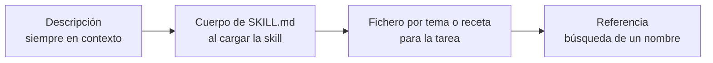
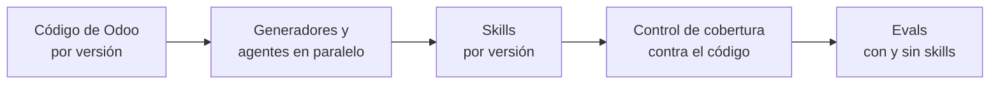
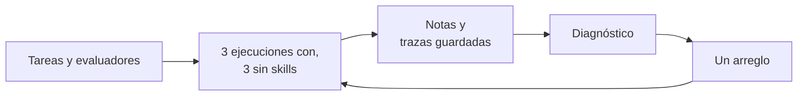
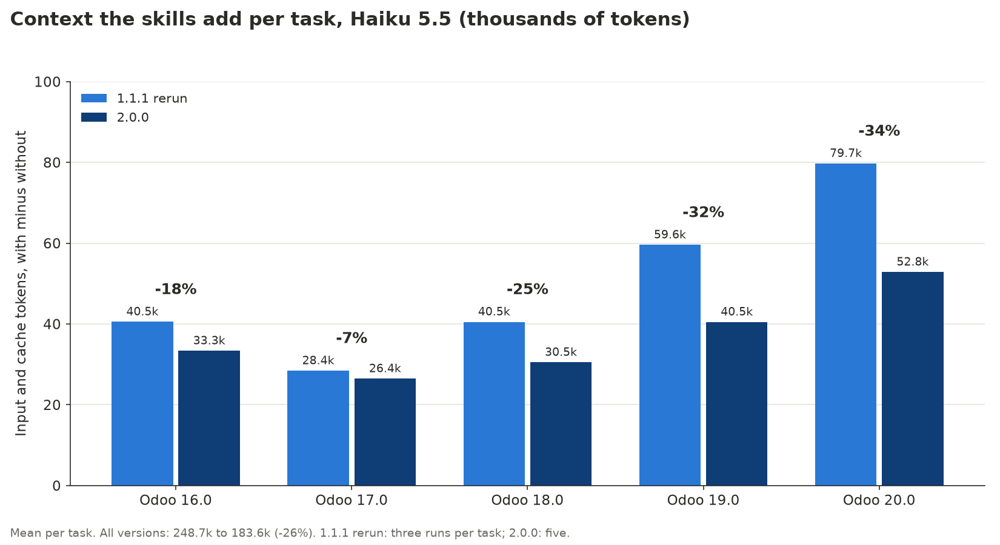
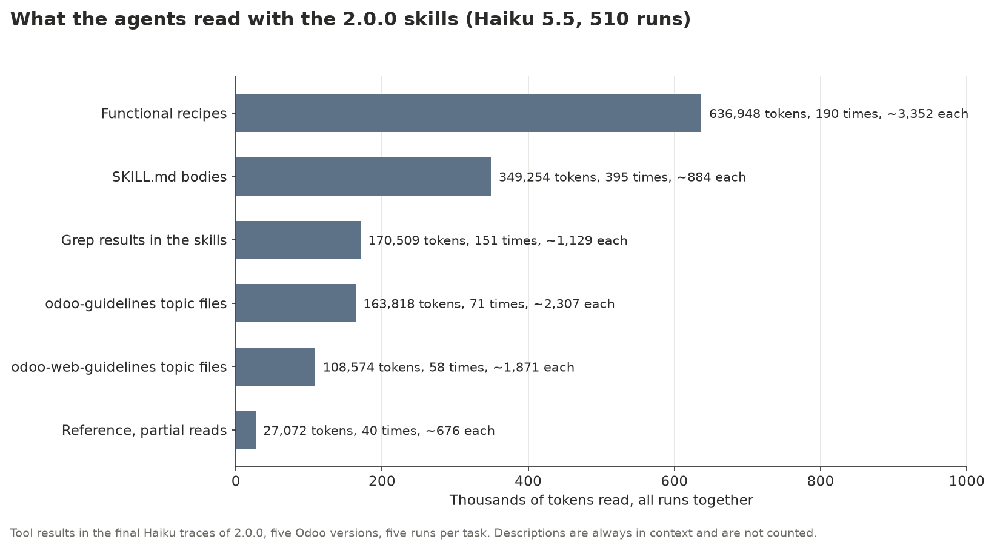

# Skills para agentes que saben qué versión de Odoo usas

*Caso de estudio de `dooservice/odoo-skills`: cómo construimos las skills, cómo las
contrastamos con el código fuente de Odoo, cómo medimos lo que aportan y cómo las mejoramos
a partir de esas mediciones. [English version](README.md).*

**Resumen.** Los agentes de IA confunden las versiones de Odoo: escriben nombres de una
versión en un proyecto que corre otra. Construimos skills para Odoo 16.0 a 20.0 y las
medimos en 102 tareas, cada una tres veces con las skills y tres veces sin ellas. En la
versión 1.1.0 las skills ya cubrían todos los módulos Community y todas las piezas del
framework de cada versión, y aun así Claude Haiku 5.5 en Odoo 20.0 solo subía del 57,5% al
71,1%. Las trazas mostraron por qué: en las tareas de código el agente nunca abría las
skills. Dos cambios pequeños en las descripciones, la única parte que el agente ve siempre,
lo llevaron al **100% en Odoo 20.0** y a entre el 97,2% y el 100% en todas las versiones;
Claude Sonnet 5.5 quedó entre el 98,3% y el 100%. Después, la versión 2.0.0 reorganizó las
skills por capas para que los agentes lean menos: el contexto que añaden por tarea bajó un
26% (un 34% en Odoo 20.0), y Haiku sacó entre el 96,1% y el 99,7% con cinco ejecuciones por
tarea. Todas las mediciones juntas costaron unos 92 USD.

## Contenido

1. [El problema](#1-el-problema)
2. [Cómo están organizadas las skills](#2-cómo-están-organizadas-las-skills)
3. [Cómo las verificamos](#3-cómo-las-verificamos)
4. [Cómo medimos](#4-cómo-medimos)
5. [Qué pasó, versión a versión](#5-qué-pasó-versión-a-versión)
6. [El diagnóstico y los dos arreglos](#6-el-diagnóstico-y-los-dos-arreglos)
7. [Ahorrar contexto: 2.0.0](#7-ahorrar-contexto-200)
8. [Coste y tokens](#8-coste-y-tokens)
9. [Lecciones para quien construya skills](#9-lecciones-para-quien-construya-skills)
10. [Lo siguiente: 2.1.0](#10-lo-siguiente-210)
11. [Cómo reproducirlo](#11-cómo-reproducirlo)

## 1. El problema

Odoo cambia nombres entre versiones mayores, y los datos con los que se entrena un modelo
las mezclan todas. Algunas de las diferencias que siguen las skills:

| | 16.0 | 17.0 | 18.0 | 19.0 | 20.0 |
|---|---|---|---|---|---|
| Vista de lista | `<tree>` | `<tree>` | `<list>` | `<list>` | `<list>` |
| Restricciones SQL | `_sql_constraints` | `_sql_constraints` | `_sql_constraints` | `models.Constraint` | `models.Constraint` |
| Dominios | `expression.AND/OR` | `expression.AND/OR` | `expression.AND/OR` | `Domain` | `Domain` |
| Permisos de acceso | `ir.model.access.csv` | `ir.model.access.csv` | `ir.model.access.csv` | `ir.model.access.csv` | `ir.access.csv` |
| Owl | 2 | 2 | 2 | 2 | 3 |

Sin skills, los dos modelos rinden peor en la versión más nueva, la que menos conocen:

| Modelo, sin skills (ejecución de 1.1.0) | 16.0 | 17.0 | 18.0 | 19.0 | 20.0 |
|---|---|---|---|---|---|
| Sonnet 5.5 | 96,1% | 94,0% | 96,1% | 94,4% | **69,2%** |
| Haiku 5.5 | 85,0% | 80,0% | 85,6% | 78,3% | **57,5%** |

Un fallo típico: se le pide una restricción de unicidad en Odoo 20.0 y el modelo escribe
`_sql_constraints`, que en 20.0 se sustituyó por `models.Constraint`. El fichero parece
correcto y pasaría una revisión rápida.

## 2. Cómo están organizadas las skills

Una skill es una carpeta con un `SKILL.md`: una descripción corta en la cabecera, un cuerpo
y los ficheros a los que el cuerpo remite. Hay un juego por versión de Odoo y dos skills
comunes a todas:

| Skill | Para | Qué contiene |
|---|---|---|
| `odoo-guidelines` | desarrollo | Python, XML y CSV de esa versión: modelos, campos, ORM, vistas, acciones, seguridad, controladores, tests, `odoo-bin`; 25 ficheros por tema |
| `odoo-web-guidelines` | desarrollo | Owl, registros, servicios, widgets, sitio web, Punto de Venta, tests JS; 10 ficheros por tema |
| `odoo-security`, `odoo-review`, `odoo-git` | desarrollo | auditorías, revisión, commits |
| `odoo-reference` | todos | cada modelo, campo, opción de Ajustes y XML id de la versión, generado desde su código |
| `odoo-functional` (común) | consultoría | configurar Odoo sin código: 70 recetas, una por flujo de negocio |
| `odoo-upgrade` (común) | desarrollo | migrar entre versiones |

El agente las recorre por capas. Tiene siempre en contexto todas las descripciones; lee el
cuerpo solo cuando decide cargar la skill, y abre los ficheros por tema y la referencia solo
cuando el cuerpo lo manda allí.



Tamaño de cada capa para Odoo 20.0 (ficheros de `odoo/20.0` y `odoo/common`; los tokens
son caracteres entre 4, así que son aproximados), en 1.1.1 y en 2.0.0:

| Capa | Ficheros 1.1.1 / 2.0.0 | Tokens aprox. 1.1.1 | Tokens aprox. 2.0.0 | Fichero mayor 1.1.1 / 2.0.0 |
|---|---|---|---|---|
| Descripciones (siempre en contexto) | 8 / 8 | 1.115 | 1.158 | 246 / 246 |
| Cuerpos de `SKILL.md` | 8 / 8 | 18.930 | 10.062 | 5.007 (`odoo-guidelines`) / 2.968 (`odoo-security`) |
| Ficheros de guías por tema | 35 / 38 | 59.553 | 66.114 | 4.495 / 3.536 |
| Recetas funcionales y `connect.md` | 71 / 72 | 192.136 | 205.763 | 4.500 / 4.492 |
| Referencia | 687 / 687 | 518.365 | 518.365 | 30.418 / 30.418 |


Las descripciones son alrededor del 0,1% del texto y deciden si el 99,9% restante llega a
leerse. Resultó ser el dato más importante de todo el proyecto (secciones 6 y 7). En 2.0.0
los cuerpos se encogieron y los ficheros por tema crecieron: el texto bajó una capa y no se
borró nada.

Las guías partieron de las skills del propio Odoo para 20.0, unas 4.800 palabras, y
crecieron hasta cubrir todas las piezas del framework de cada versión:

| | 16.0 | 17.0 | 18.0 | 19.0 | 20.0 |
|---|---|---|---|---|---|
| Ficheros de guías, palabras | 29.586 | 30.102 | 30.922 | 31.844 | 32.756 |

## 3. Cómo las verificamos

Cada nombre de las skills sale del código fuente de la versión que describe, o se contrasta
con él. El código de cada versión está descargado en `.odoo/src/<versión>`.



- **Generadores.** `tools/build_guidelines.py` construye las guías a partir de plantillas
  Markdown, con una clase pequeña por fichero para lo que cambia entre versiones.
  `tools/build_reference.py` lee del código cada modelo, campo, opción de Ajustes y XML id.
  `tools/reference/check.py` comparó la referencia con un Odoo en marcha de cada versión:
  ninguna discrepancia.
- **Agentes en paralelo.** Las 44 recetas nuevas de 1.1.0 las escribieron y revisaron
  agentes trabajando en paralelo, cada uno contrastando cada modelo, campo, valor, método y
  menú con el código de cada versión.
- **Herramienta de cobertura.** `tools/build_coverage.py` saca del código la lista de
  módulos Community y de piezas del framework (tipos de campo, decoradores `api`, tipos de
  vista y de acción, tipos de ruta y valores de `auth`, métodos públicos del ORM, registros
  del cliente web, herramientas de test) y comprueba que una receta o una guía cubre cada
  una. El informe es [`COVERAGE.md`](../../COVERAGE.md):

| Versión | Módulos | Con receta | Técnicos (sin flujo propio) | Faltan |
|---|---|---|---|---|
| 16.0 | 333 | 245 | 88 | 0 |
| 17.0 | 350 | 258 | 92 | 0 |
| 18.0 | 372 | 273 | 99 | 0 |
| 19.0 | 390 | 281 | 109 | 0 |
| 20.0 | 393 | 280 | 113 | 0 |

Las piezas del framework están cubiertas por completo en todas las versiones; por ejemplo,
métodos del ORM 63/63 en 16.0 y 59/59 en 20.0, registros del cliente web 30/30 y 32/32.

La cobertura dice que el texto existe. No dice que el agente lo lea, y eso es justo lo que
encontraron las mediciones.

## 4. Cómo medimos

Cada versión de Odoo tiene una batería de unas 20 tareas, 102 en total: 50 que escriben
código y 52 que configuran Odoo con un script de `odoo-bin shell`.

| Odoo | Tareas | Código | Funcionales |
|---|---|---|---|
| 16.0 | 20 | 10 | 10 |
| 17.0 | 21 | 11 | 10 |
| 18.0 | 20 | 10 | 10 |
| 19.0 | 22 | 12 | 10 |
| 20.0 | 19 | 7 | 12 |

Un ejemplo, `evals/odoo-20/code-unique-constraint`. El enunciado (las tareas están en
inglés):

```markdown
---
description: Odoo 20.0, code unique constraint
max_turns: 15
runs: 3
allowed_tools: [Read, Glob, Grep, Write, Skill]
---

You are working on an Odoo 20.0 project. Answer by writing the file, no explanation needed.

Write model `library.book` with fields name and isbn, and make isbn unique at database level.

Write it to `models/library_book.py`.
```

Sus tres evaluadores, cada uno un fichero pequeño:

```yaml
type: file_exists
path: "models/library_book.py"
```

```yaml
type: regex
target: { source: file, path: "models/library_book.py" }
pattern: 'models\.Constraint'
```

```yaml
type: regex
target: { source: file, path: "models/library_book.py" }
pattern: '_sql_constraints'
match: not_contains
```

Cómo funciona una medición:

- `claude plugin eval` ejecuta cada tarea **tres veces con las skills y tres sin ellas**, en
  la misma pasada, de modo que la diferencia es lo que aportan las skills.
- La nota de una tarea es la proporción de evaluadores que pasan en sus tres ejecuciones.
  Una tarea al 33% escribió el fichero pero usó los nombres de otra versión las tres veces.
- Los evaluadores son deterministas: existe un fichero, aparece un patrón, no aparece un
  patrón. 324 en total, sin ningún modelo juzgando a otro.
- Dos modelos: Claude Sonnet 5.5 y el más pequeño y barato Claude Haiku 5.5.
- Una batería tarda unos cinco minutos (de 275 a 395 segundos) y cuesta unos 0,3 USD con
  Haiku y entre 4,1 y 4,7 USD con Sonnet, contando ambos lados.



## 5. Qué pasó, versión a versión

### 1.0.0 (20 de octubre de 2026)

Guías adaptadas de las skills de Odoo 20.0 a cada versión de 16.0 a 20.0, 26 recetas
funcionales y una localización peruana. Se midió con Sonnet y solo se guardaron los totales:

| Odoo | Sin skills | Con 1.0.0 | Medido |
|---|---|---|---|
| 16.0 | 96,3% | 97,8% | 20-10-2026 |
| 17.0 | 94,7% | 99,6% | 28-10-2026 |
| 18.0 | 95,6% | 98,9% | 28-10-2026 |
| 19.0 | 92,4% | 97,0% | 28-10-2026 |
| 20.0 | 69,2% | 88,6% | 20-10-2026 |

### 1.1.0 (29 y 30 de octubre)

- **Fuera las localizaciones.** Cada país necesita contables propios que mantengan al día su
  plan de cuentas, sus impuestos y sus informes legales cuando cambia la ley. Las skills
  cubren solo los flujos estándar de Odoo.
- **A la par con las skills de Odoo**: se incorporaron `stable.md` y los dos `AUTHORING.md`.
- **Cobertura completa**: las guías pasaron de unas 4.800 palabras a unas 30.000 por
  versión, las recetas de 26 a 70, y la herramienta de cobertura no encuentra nada sin
  cubrir.
- **Un bloque de código por rango de versiones, de la más nueva a la más antigua.** Las
  recetas que mostraban como código principal la línea de la versión antigua, con la nueva
  en un comentario, hacían que el modelo copiara la antigua.
- **Baterías para 17.0, 18.0 y 19.0**, para medir las cinco versiones, también con Haiku.

Sonnet llegó a entre el 96,5% y el 100%. Haiku se quedó entre el 71,1% y el 89,4%, y en
18.0 las skills no aportaban nada (85,6% sin ellas, 85,0% con ellas).

### 1.1.1 paso 1 y 1.1.1 (30 de octubre)

Los dos arreglos de la sección 6. Notas con las skills:

| Modelo | Odoo | Sin skills | 1.0.0 | 1.1.0 | 1.1.1 paso 1 | 1.1.1 |
|---|---|---|---|---|---|---|
| Haiku 5.5 | 16.0 | 85,0% | no medido | 89,4% | 90,6% | **97,2%** |
| Haiku 5.5 | 17.0 | 80,0% | no medido | 86,5% | 88,6% | **98,3%** |
| Haiku 5.5 | 18.0 | 85,6% | no medido | 85,0% | 89,4% | **100%** |
| Haiku 5.5 | 19.0 | 78,3% | no medido | 84,3% | 94,4% | **100%** |
| Haiku 5.5 | 20.0 | 57,5% | no medido | 71,1% | 95,3% | **100%** |
| Sonnet 5.5 | 16.0 | 96,1% | 97,8% | 97,2% | 97,8% | **98,3%** |
| Sonnet 5.5 | 17.0 | 94,0% | 99,6% | 100% | no medido | no medido |
| Sonnet 5.5 | 18.0 | 96,1% | 98,9% | 100% | no medido | no medido |
| Sonnet 5.5 | 19.0 | 94,4% | 97,0% | 100% | no medido | no medido |
| Sonnet 5.5 | 20.0 | 69,2% | 88,6% | 96,5% | 97,7% | **99,4%** |

*Sin skills* es el lado sin skills de la ejecución de 1.1.0. Sonnet en 17.0 a 19.0 no se
volvió a medir: ya estaba al 100% y 1.1.1 solo cambia descripciones y el enunciado de
algunas tareas.


La ganancia frente al mismo modelo sin skills, con ambos lados de la misma ejecución:


Con 1.1.1, Haiku llega a entre el 96% y el 100% en los dos tipos de tarea; las mayores
subidas están en el código de 20.0 (del 57% al 100%) y en las tareas funcionales de 19.0 y
20.0:


### 2.0.0 (30 de octubre)

El plan que esta página llamaba 1.2.0: el mismo contenido por capas, para que el agente lea
menos y dé la misma respuesta (sección 7). Se midió frente a una repetición de 1.1.1 con
tokens exactos, y sus ejecuciones finales usan cinco ejecuciones por tarea con Haiku. Notas
con las skills, Haiku 5.5:

| Odoo | Sin skills | 1.1.1 | Repetición 1.1.1 | 2.0.0 paso 1 | 2.0.0 | 2.0.0 código / funcionales |
|---|---|---|---|---|---|---|
| 16.0 | 93,3% | 97,2% | 90,6% | 97,8% | **99,7%** | 100% / 99,3% |
| 17.0 | 88,5% | 98,3% | 95,1% | 95,4% | **99,7%** | 100% / 99,3% |
| 18.0 | 87,2% | 100% | 98,9% | 97,1% | **97,3%** | 98,0% / 96,7% |
| 19.0 | 77,6% | 100% | 96,5% | 97,5% | **96,1%** | 97,2% / 94,7% |
| 20.0 | 58,9% | 100% | 97,1% | 98,2% | **98,6%** | 97,1% / 99,4% |

*Sin skills* es el lado sin skills de la ejecución de 2.0.0. *2.0.0 paso 1* es la primera
reorganización, medida antes del diagnóstico y de las pruebas de la sección 7. Sonnet 5.5
en 20.0: 99,4% con 1.1.1 y 99,4% con 2.0.0. Las gráficas de arriba incluyen 2.0.0, y
también tarea a tarea:


Las notas se mantuvieron y el contexto añadido bajó una cuarta parte. La columna 1.1.1 y la
repetición de las mismas skills difieren hasta en 6,6 puntos: es ruido, y se explica en la
sección 7.

## 6. El diagnóstico y los dos arreglos

Los números de 1.1.0 tenían un patrón. En 20.0, las tareas funcionales de Haiku subían del
58,6% al 76,4% con las skills, pero las de código solo del 55,6% al 61,9%, y es en el código
donde las guías tienen más que decir. Antes de tocar nada, repetimos las seis tareas que
fallaban guardando sus trazas (0,08 USD) y las leímos:

- En las tareas de código el agente, Sonnet incluido, **nunca cargaba `odoo-guidelines`**.
  Escribía el fichero de memoria, con nombres de otra versión.
- En las funcionales cargaba `odoo-functional`, seguía la receta y acertaba los nombres.

Las skills estaban bien; el agente no las abría. Lo único que había visto era la
descripción, y la de `odoo-guidelines` parecía un índice:

```yaml
description: >-
  House rules for Odoo 20.0 code and what exists in 20.0 (names and
  APIs change between versions): module structure, manifest, models and
  inheritance, fields, display names, SQL constraints and indexes, ...
```

**Paso 1: las descripciones de las guías.** Las descripciones de `odoo-guidelines` y
`odoo-web-guidelines` pasan a dar una orden y a llevar los nombres que más cambian en esa
versión:

```yaml
description: >-
  Read before writing or reviewing any Python, XML or CSV for Odoo 20.0,
  even if you know Odoo: names change between versions. In 20.0: `<list>` and
  `invisible="expr"`; `models.Constraint`; `Domain`; `aggregator`; `<chatter/>`;
  `self.env._()`; access rights and record rules are rows of one model, `ir.access`,
  in `ir.access.csv` (no `ir.model.access`, no `ir.rule`); users `group_ids`, ...
```

Haiku en 20.0 pasó del 71,1% al 95,3%, y sus tareas de código del 61,9% al 100%.

**Paso 2: la descripción de la referencia y las tareas de tests JS.** La descripción de
`odoo-reference` lleva ahora los nombres de negocio que más cambian en su versión (campos de
impuestos en las líneas de venta, correspondencias de posiciones fiscales, tipos de
ausencia, reglas de tarifas, informes de gastos, diarios bancarios, desechos). Por otro
lado, las trazas de las tareas de tests JavaScript de 16.0 a 18.0 mostraban a Haiku
gastando todos sus turnos en buscar el widget en un proyecto vacío. Los enunciados ahora
describen el widget; los evaluadores no cambiaron. Haiku llegó a entre el 97,2% y el 100% en
todas las versiones, y Sonnet a entre el 98,3% y el 100%.

Tarea a tarea, Haiku en 20.0 (gráfica en la sección 5): el paso 1 arregló todas las tareas
de código; el paso 2, las funcionales que quedaban (diario bancario, impuesto en la línea
de pedido, desecho).

El arreglo tiene un precio en turnos. Con las skills, el agente lee antes de escribir:


Haiku en 20.0 pasó de 2,8 turnos por tarea sin skills a 6,6 con 1.1.1, todavía lejos del
límite de 15, y su batería de 0,28 a 0,36 USD. La sección 7 trata de ese precio.

## 7. Ahorrar contexto: 2.0.0

1.1.1 consiguió que los agentes leyeran las skills. 2.0.0 hace que leerlas salga más
barato, para que modelos más pequeños, con ventanas de contexto más cortas, mantengan la
misma precisión. No se borró nada: el contenido bajó una capa, y el agente llega a él solo
cuando la tarea lo necesita.

### Las cuatro capas

| Capa | Qué lleva en 2.0.0 |
|---|---|
| 1. Descripción (siempre en contexto) | Quién debe leer la skill y los nombres que más cambian en esa versión, ahora con valores exactos: `detailed_type='product'`, `discount_policy='without_discount'`, sin línea `'balance'` en los plazos de pago desde 17.0, `price_include` frente a `price_include_override`, `_read_group(domain, groupby, ['__count'])` desde 17.0 |
| 2. Cuerpo de `SKILL.md` | Un mapa de tareas corto: una fila por tarea, que remite a un fichero |
| 3. Fichero por tema o receta | Empieza con un bloque corto: los nombres clave de esa versión y la lista de secciones |
| 4. Detalle | Más abajo en el mismo fichero, o para buscar: los datos de referencia se buscan con grep, no se leen |

Los cuerpos de las tres skills que más cargan los agentes, para Odoo 20.0 (tokens
aproximados, caracteres entre 4):

| Skill | Cuerpo 1.1.1 | Cuerpo 2.0.0 | Qué es ahora el cuerpo |
|---|---|---|---|
| `odoo-guidelines` | ~5.000 | ~690 | un mapa de 18 filas |
| `odoo-web-guidelines` | ~2.650 | ~480 | un mapa de 11 filas |
| `odoo-functional` | ~3.600 | ~890 | un índice agrupado de las recetas, la nota de cambios y lo esencial de `odoo-bin shell` |

El cuerpo de `odoo-functional` basta ahora para trabajar sin abrir `method.md`. Lo que
salió de los cuerpos fue a ficheros por tema nuevos (`computed_fields.md`,
`orm_advanced.md`, `registries_webclient.md`) o más abajo en los que ya había. Se añadió
una receta, `recipes/attendance-variations.md`. El CI comprueba un límite de tamaño por
fichero y por capa con `tools/check_budgets.py`.

### Cómo se midió

Los tokens son exactos: cada traza termina con un evento de resultado que da los tokens de
entrada, de caché y de salida de la ejecución. Cada tarea en `evals/history/` guarda ahora
`context_with` y `context_without`, la media de tokens de entrada y de caché por tarea en
cada lado, y `output_with`. El *contexto añadido* de una tarea es `context_with` menos
`context_without`: lo que cuestan las skills sobre la misma tarea sin ellas.

Las ejecuciones de 1.1.1 no tenían tokens exactos, así que se volvieron a medir las skills
1.1.1 (la *repetición de 1.1.1*, tres ejecuciones por tarea). Las ejecuciones finales de
2.0.0 usan cinco ejecuciones por tarea con Haiku y tres con Sonnet.

| Odoo | Sin skills | Repetición 1.1.1 | 2.0.0 | 2.0.0 código / funcionales | Contexto añadido 1.1.1 a 2.0.0 | Turnos | Coste por tarea, USD |
|---|---|---|---|---|---|---|---|
| 20.0 | 58,9% | 97,1% | **98,6%** | 97,1% / 99,4% | 79,7k a 52,8k (-34%) | 7,5 a 6,3 | 0,0049 a 0,0039 |
| 19.0 | 77,6% | 96,5% | **96,1%** | 97,2% / 94,7% | 59,6k a 40,5k (-32%) | 6,4 a 5,9 | 0,0043 a 0,0036 |
| 18.0 | 87,2% | 98,9% | **97,3%** | 98,0% / 96,7% | 40,5k a 30,5k (-25%) | 4,9 a 4,6 | 0,0035 a 0,0032 |
| 17.0 | 88,5% | 95,1% | **99,7%** | 100% / 99,3% | 28,4k a 26,4k (-7%) | 4,0 a 4,2 | 0,0031 a 0,0030 |
| 16.0 | 93,3% | 90,6% | **99,7%** | 100% / 99,3% | 40,5k a 33,3k (-18%) | 4,8 a 4,9 | 0,0034 a 0,0032 |
| Todas | | 95,6% | **98,3%** | | 248,7k a 183,6k (-26%) | | -12% |

Haiku 5.5. *Sin skills* es el lado sin skills de la ejecución de 2.0.0. El contexto
añadido es la media por tarea, en tokens. Sonnet 5.5 en 20.0: 99,4% con 1.1.1 y con 2.0.0,
37,1k tokens de contexto añadido, 4,7 turnos por tarea, 3,98 USD por batería.



### Qué leen los agentes

Los resultados de herramientas de las 510 ejecuciones finales de Haiku (102 tareas, cinco
ejecuciones cada una) muestran a dónde van los tokens:



- **Las recetas son la parte mayor**: el 44% de lo que leen los agentes, unos 3.350 tokens
  cada una, y se leen enteras.
- **Los cuerpos de las skills** cuestan unos 880 tokens por carga. Ahora son pequeños,
  pero se cargan a menudo.
- **`method.md`** se leía antes en 1 de cada 3 ejecuciones funcionales; cuando el cuerpo
  de `odoo-functional` pasó a llevar la nota de cambios, en 4 de 306.
- **La referencia** se busca, como estaba previsto: 40 lecturas parciales de unos 680
  tokens cada una.

### Qué funcionó: valores exactos en la descripción

Antes de recortar, guardamos las trazas de 16.0 y 17.0 y las leímos (0,63 USD). Todos los
fallos con las skills ocurrieron en ejecuciones en las que el agente no cargó ninguna skill
y escribió de memoria. En las 62 ejecuciones en las que cargó una skill, no falló ninguna.
Así que la capa que más importa sigue siendo la descripción: decide si se lee todo lo
demás. Poner en ella el valor exacto, no solo el nombre del tema, arregló los productos
almacenables, el descuento de la tarifa, el plazo de pago, los impuestos incluidos en el
precio y los recuentos agrupados.

### Qué falló y se deshizo

Cada idea se midió; tres no compensaron y se quitaron:

- Una línea en la descripción, "read before any `odoo-bin shell` script", hizo que los
  agentes cargaran más skills, un turno más por tarea, sin subir ninguna nota.
- Una indicación, "open the recipe and load `odoo-reference` in the same turn", no se
  siguió nunca (0 de 36 llamadas en paralelo) y solo añadió un turno.
- "Run these from this skill's folder" hizo que los agentes escribieran su respuesta
  dentro de la carpeta de la skill: en 23 de 306 ejecuciones se denegó la escritura. Se
  reescribió para buscar desde la carpeta de la skill y escribir en el proyecto.

### Las pruebas que estaban mal

Tres fallos eran culpa de la evaluación, no de las skills:

- El evaluador de visibilidad condicional de 16.0 no aceptaba `<attribute name="attrs">`,
  que es correcto en una vista heredada.
- Las tareas de permisos de acceso pedían `security/access_rights.csv`, un nombre que Odoo
  no puede importar: el nombre del CSV indica el modelo. Ahora piden `ir.model.access.csv`
  (19.0) e `ir.access.csv` (20.0). Sonnet había escrito el nombre correcto y perdía la
  tarea.
- La descripción de 20.0 decía "no `company_type`", y Sonnet lo copió en un comentario,
  algo que nuestra propia regla prohíbe (ningún nombre de otra versión, ni en
  comentarios). Ahora dice qué hace de un contacto una empresa en 20.0, sin el nombre
  antiguo.

Con los dos últimos arreglos, Sonnet en 20.0 pasó del 96,5% al 99,4% con las mismas skills.

### Por qué -26% y no -30%

El objetivo era un 30% menos de contexto añadido. Llegamos a un 26% en total, un 34% en
20.0 y un 32% en 19.0. Lo que queda son turnos, no lectura. Cada turno vuelve a enviar todo
el contexto, y con skills el agente necesita al menos tres turnos (cargar la skill, leer un
fichero, escribir la respuesta) donde sin ellas necesita uno o dos. 16.0 y 17.0 ya eran
ligeras en 1.1.1, así que había poco que recortar.

### Ruido

La primera ejecución de 1.1.1 dio un 100% en 18.0 a 20.0. La repetición con las mismas
skills dio entre el 94% y el 99%. Con tres ejecuciones por tarea, una batería se mueve unos
3 puntos arriba o abajo por azar, así que la comparación final usa cinco ejecuciones por
tarea, y 2.0.0 se compara con la repetición, no con el número antiguo. Parte del ruido que
queda es del arnés: la carpeta temporal de una tarea tiene una ruta muy larga y Haiku a
veces la escribe mal al guardar la respuesta, así que se deniega la escritura. Afecta por
igual a las ejecuciones de 1.1.1 y de 2.0.0.

## 8. Coste y tokens

| Fecha | Qué se midió | Coste | Entrada | Escritura en caché | Lectura de caché | Salida | Tokens |
|---|---|---|---|---|---|---|---|
| 20-10-2026 | 1.0.0, Sonnet en 16.0 y 20.0, con las pruebas de desarrollo | unos 14 USD | 26.241 | 3.381.689 | 13.471.391 | 357.535 | exactos (Sonnet) |
| 28-10-2026 | skills 1.0.0 en las nuevas baterías de 17.0 a 19.0, Sonnet | 12,35 USD | 2.292 | 3.088.714 | 12.058.980 | 341.554 | exactos |
| 30-10-2026 | 1.1.0, Haiku, cinco versiones | 1,40 USD | 3.903 | 5.453.138 | 25.167.330 | 15.009 | estimados |
| 30-10-2026 | 1.1.0, Sonnet, cinco versiones | 21,75 USD | 4.046 | 5.440.157 | 21.239.534 | 601.576 | estimados |
| 30-10-2026 | Diagnóstico: 6 tareas con trazas | 0,08 USD | 86 | 123.061 | 541.889 | 692 | exactos |
| 30-10-2026 | 1.1.1 paso 1, Haiku, cinco versiones | 1,55 USD | 4.306 | 6.016.813 | 27.768.804 | 16.561 | estimados |
| 30-10-2026 | 1.1.1 paso 1, Sonnet, 20.0 y 16.0 | 8,72 USD | 1.622 | 2.181.455 | 8.516.865 | 241.227 | estimados |
| 30-10-2026 | 1.1.1, Haiku, cinco versiones | 1,68 USD | 4.686 | 6.548.200 | 30.221.263 | 18.023 | estimados |
| 30-10-2026 | 1.1.1, Sonnet, 20.0 y 16.0 | 8,75 USD | 1.628 | 2.188.633 | 8.544.889 | 242.020 | estimados |
| 30-10-2026 | Repetición de 1.1.1 con tokens exactos, Haiku, cinco versiones | 1,75 USD | 3.850 | 7.568.549 | 27.260.839 | 1.054.152 | exactos |
| 30-10-2026 | Repetición de 1.1.1, tokens sin leer (fallo del analizador) | 1,70 USD | sin leer | sin leer | sin leer | sin leer | ninguno |
| 30-10-2026 | 2.0.0 paso 1, Haiku, cinco versiones | 1,67 USD | 3.764 | 7.203.414 | 24.837.911 | 1.036.925 | exactos |
| 30-10-2026 | Diagnóstico con trazas, Haiku en 16.0 y 17.0 | 0,63 USD | 1.376 | 2.762.716 | 8.660.311 | 400.600 | exactos |
| 30-10-2026 | Pruebas de 2.0.0, Haiku, tres rondas | 4,98 USD | 11.708 | 21.014.532 | 78.492.671 | 3.127.399 | exactos |
| 30-10-2026 | 2.0.0, Haiku, cinco versiones, cinco ejecuciones por tarea | 2,67 USD | 6.112 | 11.396.263 | 39.319.512 | 1.697.611 | exactos |
| 30-10-2026 | 2.0.0 arreglo de servicios, Haiku en 19.0, cinco ejecuciones | 0,63 USD | 1.482 | 2.600.811 | 9.913.080 | 408.767 | exactos |
| 30-10-2026 | 2.0.0, Sonnet en 20.0, dos ejecuciones | 7,98 USD | 1.494 | 2.131.262 | 8.070.204 | 184.507 | exactos |

Total: unos 92,30 USD, de los que 22,01 USD son del trabajo de 2.0.0. Los costes son lo que cobró la API. Los tokens exactos salen de la
exportación de uso de la consola de Anthropic o de las trazas de una ejecución. Los
estimados son el coste de la ejecución por los tokens por dólar medidos con datos exactos
del mismo modelo (la exportación del 28 de octubre para Sonnet, diez trazas guardadas para
Haiku).


Por qué medir sale barato: casi toda la entrada se lee de la caché de prompts. Cada tarea
empieza con el mismo prompt de sistema, las mismas herramientas y las mismas descripciones
de skills, así que tras la primera llamada todo eso son lecturas de caché, que se cobran a
una fracción de la entrada nueva. El 28 de octubre, por ejemplo, 12,06 de los 15,15 millones
de tokens de entrada (el 80%) fueron lecturas de caché y solo 2.292 fueron entrada nueva;
en las ejecuciones finales de 2.0.0 con Haiku, 39,3 de 50,7 millones (el 78%). Una batería
con Haiku cuesta unos 0,3 USD con tres ejecuciones por tarea; con Sonnet, entre 13 y 15
veces más.

## 9. Lecciones para quien construya skills

1. **La descripción es lo único que el agente ve siempre.** Escríbela como una orden («léela
   antes de escribir cualquier fichero para Odoo 20.0») y pon en ella los nombres que el
   modelo tiene más probabilidad de fallar. Aquí valió 24 puntos por sí sola.
2. **Mide con un modelo pequeño.** Sonnet sacó un 96,5% en 20.0 con las mismas skills con
   las que Haiku sacó un 71,1%. Un modelo potente esconde que las skills no se leen.
3. **Mide siempre con y sin skills, en la misma ejecución.** Sin esa base, el 98% de Sonnet
   en 16.0 no dice nada: por su cuenta ya saca entre el 95% y el 96%.
4. **Usa evaluadores deterministas.** «El fichero existe», «contiene», «no contiene» son
   baratos, repetibles y fáciles de depurar. Ningún modelo juzga a otro.
5. **Evalúa lo que no debe aparecer, no solo lo que debe aparecer.** La mayoría de los
   errores de versión son un nombre de otra versión, y solo un evaluador `not_contains` los
   detecta.
6. **Ejecuta cada tarea varias veces.** Tres ejecuciones por lado convierten un acierto con
   suerte en un 33% o un 67% y muestran qué tareas son inestables.
7. **Guarda las trazas y léelas antes de cambiar nada.** El diagnóstico costó 0,08 USD y
   mostró la causa a la primera; ningún contenido adicional lo habría arreglado.
8. **Cambia una cosa por paso y vuelve a medir.** Los pasos 1 y 2 se midieron por separado,
   así que se conoce el efecto de cada uno.
9. **Si un modelo falla por un motivo ajeno a lo que mides, revisa la tarea.** Las tareas de
   tests JS medían la búsqueda en un proyecto vacío, no el conocimiento de Odoo. Arregla el
   enunciado, nunca los evaluadores.
10. **Un bloque de código por rango de versiones, de la más nueva a la más antigua, sin
    otras versiones en comentarios.** Los modelos copian la primera línea que ven.
11. **Contrasta cada nombre con el código de cada versión**, y genera lo que se pueda
    generar (la referencia) en lugar de escribirlo a mano.
12. **Deja que una herramienta te diga qué falta.** Un informe de cobertura sacado del código
    convierte «creo que lo cubrimos» en «faltan 0».
13. **Deja fuera lo que no puedas mantener.** Las localizaciones se quitaron antes que
    dejarlas quedarse desfasadas.
14. **Vigila turnos y coste, no solo la nota.** Las mejores notas vinieron con más turnos;
    2.0.0 recortó un 26% el contexto que añaden las skills sin perder un punto.
15. **Mide el ruido antes de fiarte de un cambio.** Las mismas skills sacaron un 100% y
    luego entre el 94% y el 99%: con tres ejecuciones una batería se mueve unos 3 puntos
    por azar. Compara con una repetición y usa más ejecuciones en la comparación que decide.
16. **Pon valores exactos en la descripción, no temas.** Todos los fallos con las skills
    salieron de ejecuciones que no cargaron ninguna skill. Un valor como
    `detailed_type='product'` en la descripción arregla la tarea aunque no se lea nada más.
17. **Mide tokens y lee lo que leen los agentes.** Los tokens exactos de cada traza
    mostraron que las recetas eran la parte mayor y que el suelo son los turnos, no los
    ficheros: cada turno vuelve a enviar todo el contexto.
18. **Mide cada indicación y deshaz lo que no compense.** Indicaciones que parecían útiles
    ("in the same turn", "from this skill's folder") añadieron turnos o rompieron la
    tarea. Y cuando un modelo potente falla, revisa primero la prueba: dos de las tareas
    que perdió Sonnet eran culpa de la evaluación.

## 10. Lo siguiente: 2.1.0

Las skills son correctas, los agentes las leen y, desde 2.0.0, leen menos. El CI comprueba
los límites de tamaño y cada medición guarda tokens exactos, así que el siguiente recorte se
puede medir igual. Sin decidir todavía:

- **Dividir las recetas más leídas que mezclan dos temas**: plazos de pago y posiciones
  fiscales, impuestos y diarios, empleados y gastos. Las recetas se leen enteras y son la
  mayor parte de lo que leen los agentes; el ahorro esperado es de un 3% a un 5% más.
- **Menos turnos, no menos palabras.** Los turnos son ahora el suelo del contexto añadido;
  cualquier cambio que ahorre un turno vale más que un texto más corto.

## 11. Cómo reproducirlo

Ejecutar una batería (aquí 20.0 con Haiku), como explica [`evals/README.md`](../../evals/README.md):

```bash
plugin=$(mktemp -d)/odoo-20
mkdir -p "$plugin/.claude-plugin" "$plugin/skills"
cp -r odoo/20.0/* odoo/common/* "$plugin/skills/"
cp -r evals "$plugin/evals"
echo '{"name": "odoo-20", "version": "1.0.0"}' > "$plugin/.claude-plugin/plugin.json"

claude plugin eval "$plugin" --eval-dir evals/odoo-20 --allow-tools Write \
  --runs 3 --model claude-haiku-5-5 --max-cost-usd 10 --threshold 0
```

La comparación final de 2.0.0 usó `--runs 5`.

Comprobar la cobertura contra el código (necesita `.odoo/src/<versión>`, ver el README
principal):

```bash
python3 tools/build_coverage.py --check
```

Dibujar las gráficas de esta página a partir de `evals/history/` y de las skills:

```bash
uv run --with matplotlib python tools/build_case_study.py
```

Los datos: [`evals/RESULTS.md`](../../evals/RESULTS.md) con cada medición,
[`evals/history/`](../../evals/history/) con cada ejecución tarea a tarea,
[`COVERAGE.md`](../../COVERAGE.md) y [`CHANGELOG.md`](../../CHANGELOG.md).
