# Building agent skills that know which Odoo version you run

*A case study of `dooservice/odoo-skills`: how the skills were built, checked against
Odoo's source, measured with and without them, and improved from the measurements.
[Spanish version](README.es.md).*

**Summary.** AI agents mix up Odoo versions: they write the names of one version in a
project that runs another. We built agent skills for Odoo 16.0 to 20.0 and measured them on
102 tasks, each run three times with the skills and three times without. With release
1.1.0 the skills already covered every Community module and framework feature of each
version, yet Claude Haiku 5.5 on Odoo 20.0 only went from 57.5% to 71.1%. Traces showed why:
on code tasks the agent never opened the skills. Two small changes to the skill
descriptions, the one part an agent always sees, took it to **100% on Odoo 20.0** and to
97.2% to 100% on every version, with Claude Sonnet 5.5 at 98.3% to 100%. Release 2.0.0 then
reorganized the skills in layers so agents read less: the context the skills add per task
fell 26% (34% on Odoo 20.0), and Haiku scored 96.1% to 99.7% over five runs per task. Every
measurement together cost about 92 USD.

## Contents

1. [The problem](#1-the-problem)
2. [How the skills are structured](#2-how-the-skills-are-structured)
3. [How we checked them](#3-how-we-checked-them)
4. [How we measured](#4-how-we-measured)
5. [What happened, release by release](#5-what-happened-release-by-release)
6. [The diagnosis and the two fixes](#6-the-diagnosis-and-the-two-fixes)
7. [Saving context: 2.0.0](#7-saving-context-200)
8. [Cost and tokens](#8-cost-and-tokens)
9. [Lessons for anyone building skills](#9-lessons-for-anyone-building-skills)
10. [What is next: 2.1.0](#10-what-is-next-210)
11. [How to reproduce](#11-how-to-reproduce)

## 1. The problem

Odoo changes names between major versions, and a model's training data mixes all of them.
A few of the differences the skills track:

| | 16.0 | 17.0 | 18.0 | 19.0 | 20.0 |
|---|---|---|---|---|---|
| List view | `<tree>` | `<tree>` | `<list>` | `<list>` | `<list>` |
| SQL constraints | `_sql_constraints` | `_sql_constraints` | `_sql_constraints` | `models.Constraint` | `models.Constraint` |
| Domains | `expression.AND/OR` | `expression.AND/OR` | `expression.AND/OR` | `Domain` | `Domain` |
| Access rights | `ir.model.access.csv` | `ir.model.access.csv` | `ir.model.access.csv` | `ir.model.access.csv` | `ir.access.csv` |
| Owl | 2 | 2 | 2 | 2 | 3 |

Without skills, both models did worst on the newest version, where they know least:

| Model, no skills (1.1.0 run) | 16.0 | 17.0 | 18.0 | 19.0 | 20.0 |
|---|---|---|---|---|---|
| Sonnet 5.5 | 96.1% | 94.0% | 96.1% | 94.4% | **69.2%** |
| Haiku 5.5 | 85.0% | 80.0% | 85.6% | 78.3% | **57.5%** |

A typical failure: asked for a unique constraint on Odoo 20.0, the model writes
`_sql_constraints`, which 20.0 replaced with `models.Constraint`. The file looks right and
would pass a quick review.

## 2. How the skills are structured

A skill is a folder with a `SKILL.md`: a short description in its front matter, a body,
and any files the body points to. There is one set per Odoo version, plus two skills shared
by every version:

| Skill | For | What it holds |
|---|---|---|
| `odoo-guidelines` | developers | Python, XML and CSV for that version: models, fields, ORM, views, actions, security, controllers, tests, `odoo-bin`; 25 topic files |
| `odoo-web-guidelines` | developers | Owl, registries, services, widgets, website, Point of Sale, JS tests; 10 topic files |
| `odoo-security`, `odoo-review`, `odoo-git` | developers | audits, review, commits |
| `odoo-reference` | everyone | every model, field, Settings switch and XML id of the version, generated from its source |
| `odoo-functional` (shared) | consultants | configuring Odoo without code: 70 recipes, one per business flow |
| `odoo-upgrade` (shared) | developers | porting between versions |

An agent meets them in layers. It always has every description in context; it reads a
body only when it decides to load the skill, and opens topic files and the reference only
when the body sends it there.

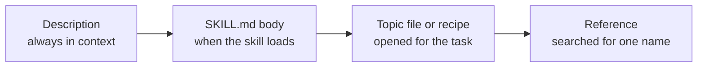

Size of each layer for Odoo 20.0 (files of `odoo/20.0` and `odoo/common`; tokens are
characters divided by 4, so approximate), in 1.1.1 and in 2.0.0:

| Layer | Files 1.1.1 / 2.0.0 | Approx. tokens 1.1.1 | Approx. tokens 2.0.0 | Largest file 1.1.1 / 2.0.0 |
|---|---|---|---|---|
| Descriptions (always in context) | 8 / 8 | 1,115 | 1,158 | 246 / 246 |
| `SKILL.md` bodies | 8 / 8 | 18,930 | 10,062 | 5,007 (`odoo-guidelines`) / 2,968 (`odoo-security`) |
| Guideline topic files | 35 / 38 | 59,553 | 66,114 | 4,495 / 3,536 |
| Functional recipes and `connect.md` | 71 / 72 | 192,136 | 205,763 | 4,500 / 4,492 |
| Reference | 687 / 687 | 518,365 | 518,365 | 30,418 / 30,418 |

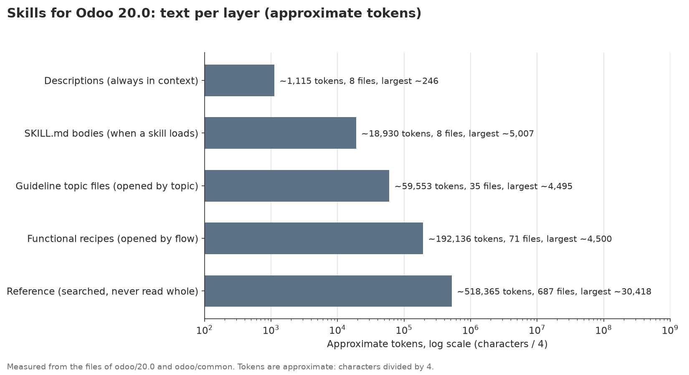

The descriptions are about 0.1% of the text and decide whether the other 99.9% is ever
read. That turned out to be the most important fact of the whole project (sections 6
and 7). In 2.0.0 the bodies shrank and the topic files grew: text moved down a layer, and
nothing was deleted.

The guidelines started from Odoo's own skills for 20.0, about 4,800 words, and grew to
cover every framework feature of each version:

| | 16.0 | 17.0 | 18.0 | 19.0 | 20.0 |
|---|---|---|---|---|---|
| Guideline topic files, words | 29,586 | 30,102 | 30,922 | 31,844 | 32,756 |

## 3. How we checked them

Every name in the skills comes from, or is checked against, the source of the version it
describes. The source of each version is checked out in `.odoo/src/<version>`.

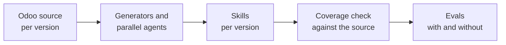

- **Generators.** `tools/build_guidelines.py` builds the guideline skills from Markdown
  templates, with one small class per file for what differs between versions.
  `tools/build_reference.py` reads every model, field, Settings switch and XML id from the
  source. `tools/reference/check.py` compared the reference with a running Odoo of each
  version: no mismatch.
- **Parallel agents.** The 44 recipes added in 1.1.0 were written and checked by agents
  working in parallel, each checking every model, field, value, method and
  menu against the source of every version.
- **Coverage tool.** `tools/build_coverage.py` lists every Community module and every
  framework item (field types, `api` decorators, view and action types, route types and
  `auth` values, public ORM methods, web client registries, test tools) from the source,
  and checks that a recipe or a guideline covers it. The report is
  [`COVERAGE.md`](../../COVERAGE.md):

| Version | Modules | Covered by a recipe | Technical (no flow of its own) | Missing |
|---|---|---|---|---|
| 16.0 | 333 | 245 | 88 | 0 |
| 17.0 | 350 | 258 | 92 | 0 |
| 18.0 | 372 | 273 | 99 | 0 |
| 19.0 | 390 | 281 | 109 | 0 |
| 20.0 | 393 | 280 | 113 | 0 |

Framework items are covered in full in every version, for example ORM methods 63/63 in
16.0 and 59/59 in 20.0, web client registries 30/30 and 32/32.

Coverage says the text exists. It does not say an agent reads it, which is what the
measurements found.

## 4. How we measured

Each Odoo version has a suite of about 20 tasks, 102 in all: 50 that write code and 52
that configure Odoo with an `odoo-bin shell` script.

| Odoo | Tasks | Code | Functional |
|---|---|---|---|
| 16.0 | 20 | 10 | 10 |
| 17.0 | 21 | 11 | 10 |
| 18.0 | 20 | 10 | 10 |
| 19.0 | 22 | 12 | 10 |
| 20.0 | 19 | 7 | 12 |

An example, `evals/odoo-20/code-unique-constraint`. The prompt:

```markdown
---
description: Odoo 20.0, code unique constraint
max_turns: 15
runs: 3
allowed_tools: [Read, Glob, Grep, Write, Skill]
---

You are working on an Odoo 20.0 project. Answer by writing the file, no explanation needed.

Write model `library.book` with fields name and isbn, and make isbn unique at database level.

Write it to `models/library_book.py`.
```

Its three graders, each a small file:

```yaml
type: file_exists
path: "models/library_book.py"
```

```yaml
type: regex
target: { source: file, path: "models/library_book.py" }
pattern: 'models\.Constraint'
```

```yaml
type: regex
target: { source: file, path: "models/library_book.py" }
pattern: '_sql_constraints'
match: not_contains
```

How a run works:

- `claude plugin eval` runs every task **three times with the skills and three times
  without**, in the same run, so the difference is what the skills add.
- The score of a task is the share of its graders that pass over its three runs. A task at
  33% wrote the file but used the wrong version's names every time.
- Graders are deterministic: a file exists, a pattern is present, a pattern is absent.
  324 graders in all, no model judging another model.
- Two models: Claude Sonnet 5.5 and the smaller, cheaper Claude Haiku 5.5.
- A suite takes about five minutes (275 to 395 seconds) and costs about 0.3 USD with
  Haiku and 4.1 to 4.7 USD with Sonnet, both sides included.

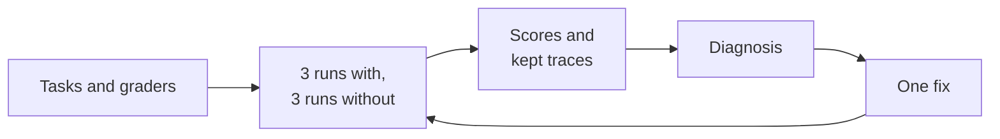

## 5. What happened, release by release

### 1.0.0 (2026-10-20)

Guidelines adapted from Odoo's own 20.0 skills to each version from 16.0 to 20.0, 26
functional recipes and a Peru localization. Measured with Sonnet; only the totals were
kept:

| Odoo | Without | With 1.0.0 | Measured |
|---|---|---|---|
| 16.0 | 96.3% | 97.8% | 2026-10-20 |
| 17.0 | 94.7% | 99.6% | 2026-10-28 |
| 18.0 | 95.6% | 98.9% | 2026-10-28 |
| 19.0 | 92.4% | 97.0% | 2026-10-28 |
| 20.0 | 69.2% | 88.6% | 2026-10-20 |

### 1.1.0 (2026-10-29 and 30)

- **Localizations removed.** Each country needs its own accountants to keep its chart,
  taxes and legal reports right as its law changes. The skills cover Odoo's standard flows
  only.
- **Parity with Odoo's skills**: `stable.md` and both `AUTHORING.md` brought in.
- **Complete coverage**: guidelines grew from about 4,800 words to about 30,000 per
  version, recipes from 26 to 70, and the coverage tool reports 0 missing.
- **One code block per version range, newest first.** Recipes that showed the old
  version's line as the main code, with the new version in a comment, made models copy the
  old line.
- **Suites for 17.0, 18.0 and 19.0**, so all five versions are measured, with Haiku as
  well.

Sonnet reached 96.5% to 100%. Haiku stayed between 71.1% and 89.4%, and on 18.0 the skills
gained nothing (85.6% without, 85.0% with).

### 1.1.1 step 1 and 1.1.1 (2026-10-30)

The two fixes of section 6. Scores with the skills:

| Model | Odoo | Without | 1.0.0 | 1.1.0 | 1.1.1 step 1 | 1.1.1 |
|---|---|---|---|---|---|---|
| Haiku 5.5 | 16.0 | 85.0% | not measured | 89.4% | 90.6% | **97.2%** |
| Haiku 5.5 | 17.0 | 80.0% | not measured | 86.5% | 88.6% | **98.3%** |
| Haiku 5.5 | 18.0 | 85.6% | not measured | 85.0% | 89.4% | **100%** |
| Haiku 5.5 | 19.0 | 78.3% | not measured | 84.3% | 94.4% | **100%** |
| Haiku 5.5 | 20.0 | 57.5% | not measured | 71.1% | 95.3% | **100%** |
| Sonnet 5.5 | 16.0 | 96.1% | 97.8% | 97.2% | 97.8% | **98.3%** |
| Sonnet 5.5 | 17.0 | 94.0% | 99.6% | 100% | not measured | not measured |
| Sonnet 5.5 | 18.0 | 96.1% | 98.9% | 100% | not measured | not measured |
| Sonnet 5.5 | 19.0 | 94.4% | 97.0% | 100% | not measured | not measured |
| Sonnet 5.5 | 20.0 | 69.2% | 88.6% | 96.5% | 97.7% | **99.4%** |

*Without* is the no-skills side of the 1.1.0 run. Sonnet on 17.0 to 19.0 was not measured
again: it was at 100% and 1.1.1 changes only descriptions and task wording.

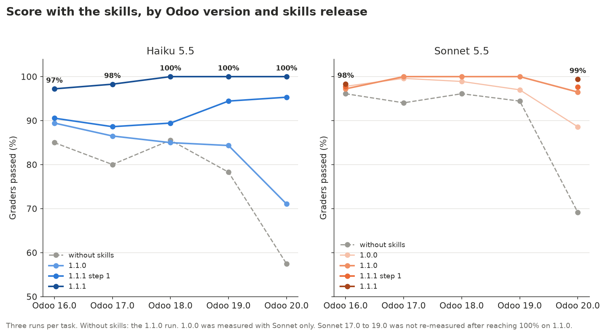

The gain over the same model without skills, both sides from the same run:

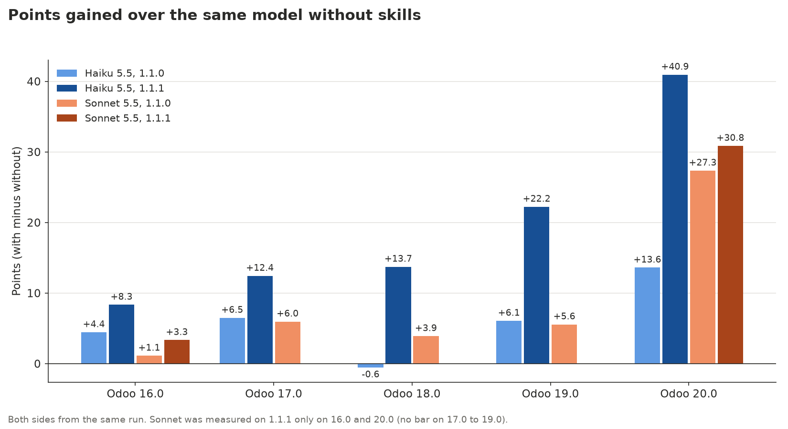

On 1.1.1, both kinds of task reach 96% to 100% with Haiku; the largest gains are on
20.0 code (57% to 100%) and on 19.0 and 20.0 functional tasks:

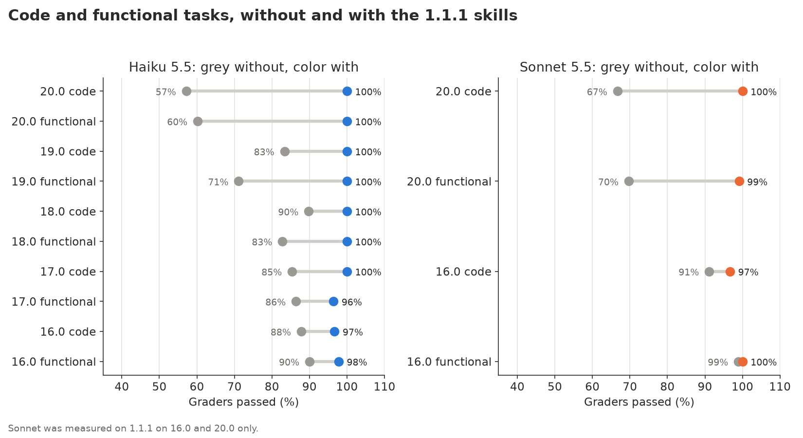

### 2.0.0 (2026-10-30)

The plan this page called 1.2.0: the same content in layers, so an agent reads less for
the same answer (section 7). It was measured against a rerun of 1.1.1 with exact tokens,
and its final runs use five runs per task with Haiku. Scores with the skills, Haiku 5.5:

| Odoo | Without | 1.1.1 | 1.1.1 rerun | 2.0.0 step 1 | 2.0.0 | 2.0.0 code / functional |
|---|---|---|---|---|---|---|
| 16.0 | 93.3% | 97.2% | 90.6% | 97.8% | **99.7%** | 100% / 99.3% |
| 17.0 | 88.5% | 98.3% | 95.1% | 95.4% | **99.7%** | 100% / 99.3% |
| 18.0 | 87.2% | 100% | 98.9% | 97.1% | **97.3%** | 98.0% / 96.7% |
| 19.0 | 77.6% | 100% | 96.5% | 97.5% | **96.1%** | 97.2% / 94.7% |
| 20.0 | 58.9% | 100% | 97.1% | 98.2% | **98.6%** | 97.1% / 99.4% |

*Without* is the no-skills side of the 2.0.0 run. *2.0.0 step 1* is the first refactor,
measured before the diagnosis and the trials of section 7. Sonnet 5.5 on 20.0: 99.4% with
1.1.1 and 99.4% with 2.0.0. The charts above include 2.0.0, task by task as well:

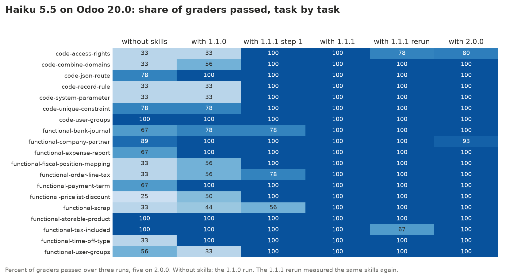

The scores held and the added context fell by a quarter. The 1.1.1 column and the rerun of
the same skills differ by up to 6.6 points: that is noise, discussed in section 7.

## 6. The diagnosis and the two fixes

The 1.1.0 numbers had a pattern. On 20.0, Haiku's functional tasks rose from 58.6% to 76.4%
with the skills, but its code tasks only from 55.6% to 61.9%, and the code tasks are where
the guidelines carry the most. Before changing anything, we ran the six failing tasks
again with their traces kept (0.08 USD) and read them:

- On code tasks the agent, Sonnet included, **never loaded `odoo-guidelines`**. It wrote
  the file from memory, with another version's names.
- On functional tasks it loaded `odoo-functional`, followed the recipe and got the names
  right.

The skills were right; the agent did not open them. The only text it had seen was the
description, and the description of `odoo-guidelines` read like a table of contents:

```yaml
description: >-
  House rules for Odoo 20.0 code and what exists in 20.0 (names and
  APIs change between versions): module structure, manifest, models and
  inheritance, fields, display names, SQL constraints and indexes, ...
```

**Step 1: the guideline descriptions.** The descriptions of `odoo-guidelines` and
`odoo-web-guidelines` now give an instruction and carry the names that change most in
that version:

```yaml
description: >-
  Read before writing or reviewing any Python, XML or CSV for Odoo 20.0,
  even if you know Odoo: names change between versions. In 20.0: `<list>` and
  `invisible="expr"`; `models.Constraint`; `Domain`; `aggregator`; `<chatter/>`;
  `self.env._()`; access rights and record rules are rows of one model, `ir.access`,
  in `ir.access.csv` (no `ir.model.access`, no `ir.rule`); users `group_ids`, ...
```

Haiku on 20.0 went from 71.1% to 95.3%, its code tasks from 61.9% to 100%.

**Step 2: the reference description, and the JS test tasks.** The description of
`odoo-reference` now carries the business names that change most in its version (tax
fields on sale lines, fiscal position mapping, time off types, pricelist rules, expense
reports, bank journals, scrap). Separately, the traces of the JavaScript test tasks of
16.0 to 18.0 showed Haiku using all its turns searching an empty project for the widget
under test. The prompts now describe the widget; the graders did not change. Haiku
reached 97.2% to 100% on every version and Sonnet 98.3% to 100%.

Task by task, Haiku on 20.0 (chart in section 5): step 1 fixed every code task; step 2
fixed the remaining functional ones (bank journal, order line tax, scrap).

The fix has a price in turns. With the skills an agent reads before it writes:

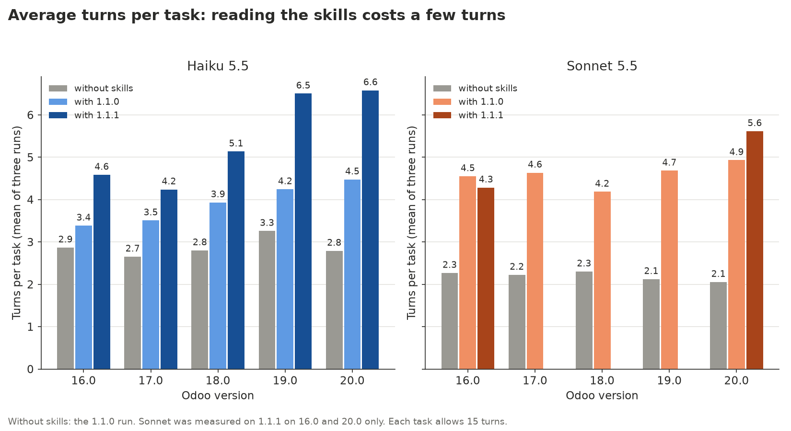

Haiku on 20.0 went from 2.8 turns per task without skills to 6.6 with 1.1.1, still far
from the limit of 15, and its suite from 0.28 to 0.36 USD. Section 7 is about that price.

## 7. Saving context: 2.0.0

1.1.1 made agents read the skills. 2.0.0 makes reading them cheaper, so that smaller
models with shorter context windows keep the same precision. Nothing was deleted: content
moved down a layer, and the agent reaches it only when the task needs it.

### The four layers

| Layer | What it carries in 2.0.0 |
|---|---|
| 1. Description (always in context) | Who should read the skill and the names that change most in that version, now with exact values: `detailed_type='product'`, `discount_policy='without_discount'`, no `'balance'` payment term line from 17.0, `price_include` vs `price_include_override`, `_read_group(domain, groupby, ['__count'])` from 17.0 |
| 2. `SKILL.md` body | A short task map: one row per task, pointing to one file |
| 3. Topic file or recipe | Starts with a short block: the key names of that version and the list of sections |
| 4. Detail | Lower in the same file, or searched: reference data is grepped, not read |

The bodies of the three skills agents load most, for Odoo 20.0 (approximate tokens,
characters divided by 4):

| Skill | Body 1.1.1 | Body 2.0.0 | What the body is now |
|---|---|---|---|
| `odoo-guidelines` | ~5,000 | ~690 | a map of 18 rows |
| `odoo-web-guidelines` | ~2,650 | ~480 | a map of 11 rows |
| `odoo-functional` | ~3,600 | ~890 | a grouped index of the recipes, the change note and the `odoo-bin shell` essentials |

The body of `odoo-functional` is now enough to work without opening `method.md`. What left
the bodies went into new topic files (`computed_fields.md`, `orm_advanced.md`,
`registries_webclient.md`) or further down existing ones. One recipe was added,
`recipes/attendance-variations.md`. The CI checks a size budget per file and per layer
with `tools/check_budgets.py`.

### How it was measured

Token counts are exact: each trace ends with a result event that gives the input, cache
and output tokens of the run. Each task in `evals/history/` now records `context_with`
and `context_without`, the mean input and cache tokens per task on each side, and
`output_with`. The *added context* of a task is `context_with` minus `context_without`:
what the skills cost on top of the same task without them.

The 1.1.1 runs had no exact tokens, so the 1.1.1 skills were measured again (the *1.1.1
rerun*, three runs per task). The final 2.0.0 runs use five runs per task with Haiku,
three with Sonnet.

| Odoo | Without | 1.1.1 rerun | 2.0.0 | 2.0.0 code / functional | Added context 1.1.1 to 2.0.0 | Turns | Cost per task, USD |
|---|---|---|---|---|---|---|---|
| 20.0 | 58.9% | 97.1% | **98.6%** | 97.1% / 99.4% | 79.7k to 52.8k (-34%) | 7.5 to 6.3 | 0.0049 to 0.0039 |
| 19.0 | 77.6% | 96.5% | **96.1%** | 97.2% / 94.7% | 59.6k to 40.5k (-32%) | 6.4 to 5.9 | 0.0043 to 0.0036 |
| 18.0 | 87.2% | 98.9% | **97.3%** | 98.0% / 96.7% | 40.5k to 30.5k (-25%) | 4.9 to 4.6 | 0.0035 to 0.0032 |
| 17.0 | 88.5% | 95.1% | **99.7%** | 100% / 99.3% | 28.4k to 26.4k (-7%) | 4.0 to 4.2 | 0.0031 to 0.0030 |
| 16.0 | 93.3% | 90.6% | **99.7%** | 100% / 99.3% | 40.5k to 33.3k (-18%) | 4.8 to 4.9 | 0.0034 to 0.0032 |
| All | | 95.6% | **98.3%** | | 248.7k to 183.6k (-26%) | | -12% |

Haiku 5.5. *Without* is the no-skills side of the 2.0.0 run. Added context is the mean per
task, in tokens. Sonnet 5.5 on 20.0: 99.4% with 1.1.1 and with 2.0.0, 37.1k tokens of added
context, 4.7 turns per task, 3.98 USD per suite.

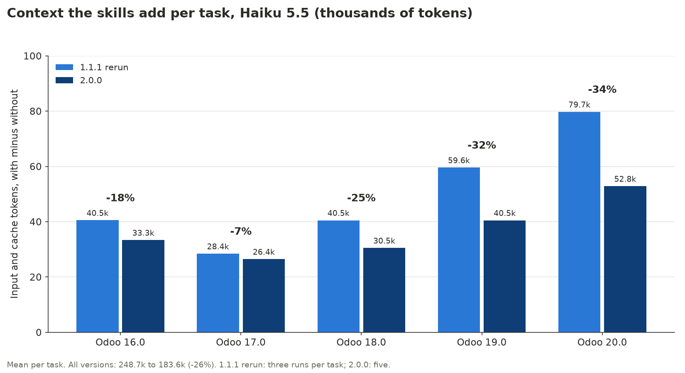

### What agents read

The tool results of the 510 final Haiku runs (102 tasks, five runs each) show where the
tokens go:

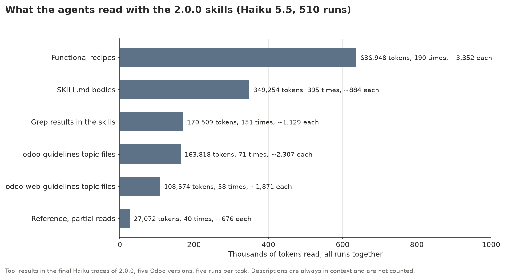

- **Recipes are the largest share**: 44% of what agents read, about 3,350 tokens each, and
  they are read whole.
- **Skill bodies** cost about 880 tokens per load. They are small now, but they load often.
- **`method.md`** was read in 1 of 3 functional runs before; once the `odoo-functional`
  body carried the change note, in 4 of 306.
- **The reference** is searched, as designed: 40 partial reads of about 680 tokens each.

### What worked: exact values in the description

Before cutting, we kept the traces of 16.0 and 17.0 and read them (0.63 USD). Every
failure with the skills happened in a run where the agent loaded no skill and wrote from
memory. In the 62 runs where it loaded a skill, it failed none. So the layer that matters
most is still the description: it decides whether anything else is read. Putting the exact
value in it, not just the name of the topic, fixed storable products, the pricelist
discount, the payment term, taxes included in the price and grouped counts.

### What failed and was reverted

Each idea was measured; three did not pay and were taken back:

- A description line "read before any `odoo-bin shell` script" made agents load more
  skills, one turn more per task, without raising any score.
- A hint "open the recipe and load `odoo-reference` in the same turn" was never followed
  (0 of 36 calls in parallel) and only added a turn.
- "Run these from this skill's folder" made agents write their answer inside the skill
  folder: 23 of 306 runs had the write denied. It was reworded to search from the skill
  folder and write in the project.

### The tests that were wrong

Three failures were the eval's fault, not the skills':

- The 16.0 conditional visibility grader did not accept `<attribute name="attrs">`, which
  is correct in an inherited view.
- The access rights tasks asked for `security/access_rights.csv`, a name Odoo cannot
  import: the CSV file name gives the model. They now ask for `ir.model.access.csv` (19.0)
  and `ir.access.csv` (20.0). Sonnet had written the right name and lost the task.
- The 20.0 description said "no `company_type`", and Sonnet copied that into a comment,
  which our own rule forbids (no other version's names, even in comments). It now says
  what makes a company in 20.0, without the old name.

With the last two fixes, Sonnet on 20.0 went from 96.5% to 99.4% on the same skills.

### Why -26% and not -30%

The goal was 30% less added context. We reached 26% overall, 34% on 20.0 and 32% on
19.0. What is left is turns, not reading. Every turn re-sends the whole context, and with
skills an agent needs at least three turns (load the skill, read a file, write the answer)
where without them it needs one or two. 16.0 and 17.0 were already light in 1.1.1, so
there was little to cut there.

### Noise

The first 1.1.1 run gave 100% on 18.0 to 20.0. The rerun of the same skills gave 94% to
99%. With three runs per task a suite moves about 3 points either way by chance, so the
final comparison uses five runs per task, and 2.0.0 is compared with the rerun, not with
the old number. Part of the noise left is the harness: the temporary folder of a task has
a very long path, and Haiku sometimes garbles it when it writes the answer, so the write is
denied. It hits 1.1.1 and 2.0.0 runs alike.

## 8. Cost and tokens

| Date | What was measured | Cost | Input | Cache write | Cache read | Output | Tokens |
|---|---|---|---|---|---|---|---|
| 2026-10-20 | 1.0.0, Sonnet on 16.0 and 20.0, with development runs | about 14 USD | 26,241 | 3,381,689 | 13,471,391 | 357,535 | exact (Sonnet) |
| 2026-10-28 | 1.0.0 skills on the new 17.0 to 19.0 suites, Sonnet | 12.35 USD | 2,292 | 3,088,714 | 12,058,980 | 341,554 | exact |
| 2026-10-30 | 1.1.0, Haiku, five versions | 1.40 USD | 3,903 | 5,453,138 | 25,167,330 | 15,009 | estimated |
| 2026-10-30 | 1.1.0, Sonnet, five versions | 21.75 USD | 4,046 | 5,440,157 | 21,239,534 | 601,576 | estimated |
| 2026-10-30 | Diagnosis: 6 failing tasks with traces | 0.08 USD | 86 | 123,061 | 541,889 | 692 | exact |
| 2026-10-30 | 1.1.1 step 1, Haiku, five versions | 1.55 USD | 4,306 | 6,016,813 | 27,768,804 | 16,561 | estimated |
| 2026-10-30 | 1.1.1 step 1, Sonnet, 20.0 and 16.0 | 8.72 USD | 1,622 | 2,181,455 | 8,516,865 | 241,227 | estimated |
| 2026-10-30 | 1.1.1, Haiku, five versions | 1.68 USD | 4,686 | 6,548,200 | 30,221,263 | 18,023 | estimated |
| 2026-10-30 | 1.1.1, Sonnet, 20.0 and 16.0 | 8.75 USD | 1,628 | 2,188,633 | 8,544,889 | 242,020 | estimated |
| 2026-10-30 | 1.1.1 rerun with exact tokens, Haiku, five versions | 1.75 USD | 3,850 | 7,568,549 | 27,260,839 | 1,054,152 | exact |
| 2026-10-30 | 1.1.1 rerun, tokens not read (parser fault) | 1.70 USD | not read | not read | not read | not read | none |
| 2026-10-30 | 2.0.0 step 1, Haiku, five versions | 1.67 USD | 3,764 | 7,203,414 | 24,837,911 | 1,036,925 | exact |
| 2026-10-30 | Diagnosis with traces, Haiku on 16.0 and 17.0 | 0.63 USD | 1,376 | 2,762,716 | 8,660,311 | 400,600 | exact |
| 2026-10-30 | 2.0.0 trials, Haiku, three rounds | 4.98 USD | 11,708 | 21,014,532 | 78,492,671 | 3,127,399 | exact |
| 2026-10-30 | 2.0.0, Haiku, five versions, five runs per task | 2.67 USD | 6,112 | 11,396,263 | 39,319,512 | 1,697,611 | exact |
| 2026-10-30 | 2.0.0 services fix, Haiku on 19.0, five runs | 0.63 USD | 1,482 | 2,600,811 | 9,913,080 | 408,767 | exact |
| 2026-10-30 | 2.0.0, Sonnet on 20.0, two runs | 7.98 USD | 1,494 | 2,131,262 | 8,070,204 | 184,507 | exact |

Total: about 92.30 USD, of which 22.01 USD for the 2.0.0 work. Costs are what the API charged. Exact tokens come from the
Anthropic Console usage export or from the traces of a run. Estimated tokens are the
run's cost times the tokens per USD measured on exact data of the same model (the
2026-10-28 export for Sonnet, ten kept Haiku traces for Haiku).

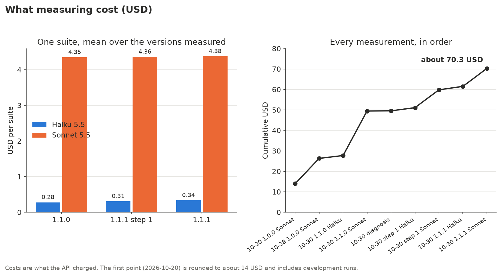

Why measuring is affordable: almost all input is read from the prompt cache. Every task
starts with the same system prompt, tools and skill descriptions, so after the first call
they are cache reads, billed at a fraction of fresh input. On 2026-10-28, for example,
12.06 million of the 15.15 million input tokens (80%) were cache reads and only 2,292
were fresh input; in the final 2.0.0 Haiku runs, 39.3 of 50.7 million (78%). A Haiku suite
costs about 0.3 USD at three runs per task; a Sonnet suite 13 to 15 times as much.

## 9. Lessons for anyone building skills

1. **The description is the only part an agent always sees.** Write it as an instruction
   ("read before writing any file for Odoo 20.0") and put in it the names the model is most
   likely to get wrong. Here it was worth 24 points on its own.
2. **Measure with a small model.** Sonnet scored 96.5% on 20.0 with the same skills on
   which Haiku scored 71.1%. A strong model hides skills that are not being read.
3. **Always measure with and without, in the same run.** Without the baseline, Sonnet's
   98% on 16.0 says nothing: it scores 95% to 96% there on its own.
4. **Use deterministic graders.** "File exists", "contains", "does not contain" are cheap,
   repeatable and easy to debug. No model judges another model.
5. **Grade what must be absent, not only what must be present.** Most version errors are
   a name from the wrong version, and only a `not_contains` grader catches them.
6. **Run each task several times.** Three runs per side turn a lucky pass into 33% or 67%
   and show which tasks are unstable.
7. **Keep traces and read them before changing anything.** The diagnosis cost 0.08 USD and
   showed the cause in one look; no amount of extra content would have fixed it.
8. **Change one thing per step and re-measure.** Step 1 and step 2 were measured apart, so
   each one's effect is known.
9. **When a model fails for the wrong reason, check the task.** The JS test tasks measured
   searching an empty project, not knowledge of Odoo. Fix the prompt, never the graders.
10. **One code block per version range, newest first, with no other version in
    comments.** Models copy the first line they see.
11. **Check every name against the source of each version**, and generate what can be
    generated (the reference) instead of writing it.
12. **Let a tool tell you what is missing.** A coverage report read from the source turns
    "I think we cover it" into "0 missing".
13. **Leave out what you cannot maintain.** The localizations were removed rather than
    left to go stale.
14. **Watch turns and cost, not only the score.** Better scores came with more turns;
    2.0.0 cut the context the skills add by 26% without losing a point.
15. **Measure the noise before you trust a change.** The same skills scored 100% and then
    94% to 99%: with three runs a suite moves about 3 points by chance. Compare against a
    rerun, and use more runs for the comparison that decides.
16. **Put exact values in the description, not topics.** Every failure with the skills
    came from a run that loaded no skill. A value such as `detailed_type='product'` in
    the description fixes the task even when nothing else is read.
17. **Measure tokens, and read what agents read.** Exact tokens per trace showed that
    recipes were the largest share and that turns, not files, are the floor: each turn
    re-sends the whole context.
18. **Measure every instruction and revert what does not pay.** Hints that sound helpful
    ("in the same turn", "from this skill's folder") added turns or broke the task. And
    when a strong model fails, check the test first: two of Sonnet's losses were the
    eval's fault.

## 10. What is next: 2.1.0

The skills are right, agents read them, and since 2.0.0 they read less. Size budgets are
checked by the CI and every measurement records exact tokens, so the next cut can be
measured the same way. Not decided yet:

- **Split the most read recipes that mix two topics**: payment terms and fiscal
  positions, taxes and journals, employees and expenses. Recipes are read whole and are
  the largest share of what agents read; the expected saving is 3% to 5% more.
- **Fewer turns, not fewer words.** Turns are now the floor of the added context; any
  change that saves a turn is worth more than shorter text.

## 11. How to reproduce

Run a suite (here 20.0 with Haiku), as described in [`evals/README.md`](../../evals/README.md):

```bash
plugin=$(mktemp -d)/odoo-20
mkdir -p "$plugin/.claude-plugin" "$plugin/skills"
cp -r odoo/20.0/* odoo/common/* "$plugin/skills/"
cp -r evals "$plugin/evals"
echo '{"name": "odoo-20", "version": "1.0.0"}' > "$plugin/.claude-plugin/plugin.json"

claude plugin eval "$plugin" --eval-dir evals/odoo-20 --allow-tools Write \
  --runs 3 --model claude-haiku-5-5 --max-cost-usd 10 --threshold 0
```

The final 2.0.0 comparison used `--runs 5`.

Check coverage against the source (needs `.odoo/src/<version>`, see the main README):

```bash
python3 tools/build_coverage.py --check
```

Draw the charts of this page from `evals/history/` and the skills:

```bash
uv run --with matplotlib python tools/build_case_study.py
```

The data: [`evals/RESULTS.md`](../../evals/RESULTS.md) for every measurement,
[`evals/history/`](../../evals/history/) for each run task by task,
[`COVERAGE.md`](../../COVERAGE.md) and [`CHANGELOG.md`](../../CHANGELOG.md).
